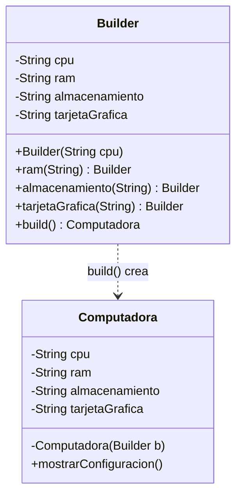

# Patrón 3. Builder

## Objetivo

Reconocer el patrón Builder, ver qué problema resuelve frente a los
constructores con muchos parámetros, y decidir cuándo conviene usarlo.

## El patrón en breve

Builder separa la construcción de un objeto complejo de su representación,
de modo que el mismo proceso pueda producir configuraciones distintas (Gamma
et al., 1994). Arma el objeto paso a paso y lo entrega terminado al final.

El problema más frecuente que lo motiva es el de los **constructores
telescópicos**. Cuando un objeto tiene varios datos opcionales, la clase
termina con un constructor por cada combinación, cada uno con un parámetro
más que el anterior. Quien lo usa debe recordar el orden de los argumentos y
rellenar con `null` los datos que no quiere dar.

En Java, la forma más usada hoy es la variante fluida que describe Bloch
(2018), pensada justo para clases con muchos parámetros opcionales. Esa es
la que se practica aquí. La versión clásica del GoF, con un `Director` que
repite una receta de armado y varios builders que producen representaciones
distintas, está en `referencia-csharp/Program.cs`.

Las piezas de la variante fluida son tres.

- **El producto** (`Computadora`), con un constructor privado y datos que no
  cambian después de creada.
- **El builder** (`Computadora.Builder`), una clase anidada con un método con
  nombre por cada dato opcional. Cada método devuelve el mismo builder, y
  eso permite encadenar las llamadas.
- **`build()`**, que entrega el producto terminado.



`Builder` es una clase anidada dentro de `Computadora`. El diagrama las
muestra por separado para que se lean mejor.

## Cuándo sí y cuándo no

Con dos o tres parámetros, un constructor normal es más claro y más corto.
Escribir un builder ahí es la sobreingeniería de la que habla el README
general. Builder empieza a valer la pena cuando se cumple alguna de estas
situaciones.

- Hay varios datos opcionales, y las combinaciones posibles crecen.
- Hay varios parámetros del mismo tipo, como los `String` de este ejemplo,
  que se pueden intercambiar sin que el compilador lo note.
- Se quiere un objeto que no cambie después de creado y que se pueda
  validar al momento de crearlo.

En otros lenguajes el problema se resuelve de maneras más simples. Por
ejemplo, en JavaScript se pasa un objeto con los campos por nombre, y no
hace falta ninguna clase aparte. En ese caso la idea del patrón está
presente en el lenguaje.

## Archivos

```
03 - Builder/
├── README.md
├── java/
│   ├── sin-patron/        Computadora.java y Principal.java
│   └── con-patron/        Computadora.java (con su Builder) y Principal.java
└── referencia-csharp/     versión original en C#, con el Director y el
                           anti-patrón, solo de consulta
```

Los programas no llevan acentos a propósito, para evitar problemas de
codificación en la consola de Windows.

## Práctica en Java (20 min)

Antes de ejecutar cada programa, anota qué crees que va a imprimir.
Comparar tu predicción con el resultado es lo más valioso de la práctica.

1. **Sin patrón.** Lee `java/sin-patron/Computadora.java` y `Principal.java`.
   Fíjate en el caso 3 (`Especial`) y en el caso 4 (`Descuido`). Predice qué
   imprimirá cada uno y ejecútalo. ¿El compilador avisó del descuido?
2. **Con patrón.** Lee `java/con-patron/Computadora.java` y `Principal.java`.
   Predice la salida de los tres casos y ejecútalo. ¿Qué cambió en la forma
   de escribir el caso 3?
3. **Comparar.** En la versión con patrón, ¿qué tendrías que escribir para
   cometer el mismo descuido del caso 4? ¿Se notaría?

### Cómo ejecutar

Desde la terminal, entra a la carpeta de cada versión y compila todo junto.

```
cd java/sin-patron
javac *.java
java Principal
```

Repite con `java/con-patron`. En VS Code, abre una versión a la vez (menú
*File > Open Folder*), porque las dos carpetas tienen clases con el mismo
nombre.

## Qué gana y qué cuesta usar Builder

| Aspecto | Sin patrón | Con patrón |
|---|---|---|
| Cómo se lee la creación | `new Computadora("Intel Core i9", "32 GB DDR5", "1 TB NVMe SSD", "NVIDIA RTX 4080")`. Hay que saber qué es cada posición | Cada dato lleva su nombre: `.ram("32 GB DDR5")` |
| Datos opcionales que no se quieren dar | Se escriben como `null` en su posición | Simplemente no se llama al método |
| Intercambiar dos datos del mismo tipo | Compila y corre, con un dato equivocado | El error se ve en la propia línea, porque el nombre no coincide con el dato |
| Agregar un dato opcional nuevo | Otro constructor, y se repasan las llamadas que usan `null` | Un método nuevo en el `Builder`. Las llamadas existentes no cambian |
| Código en la clase | Una clase con cuatro constructores | La clase, un constructor privado y un `Builder` anidado, bastante más largo |
| Costo | Los errores aparecen en tiempo de ejecución, o nunca | Más código por cada clase, y un objeto intermedio que existe solo para armar el otro |

La última fila es la que decide. El costo es real, porque cada clase con
builder necesita escribir y mantener su `Builder`. Compensa en clases con
muchos parámetros opcionales, y casi nunca en clases pequeñas.

## Patrones usados en el taller de arquitecturas (sin haberlos conocido aun)

En el [Taller de Arquitecturas de Software](https://github.com/carevalomx69/Taller-de-Arquitecturas-de-Software)
no hay builders. La razón es instructiva. El código del taller está en
JavaScript, y ahí los datos se arman con objetos que llevan el nombre de
cada campo, que es justo lo que el builder logra en Java.

| Práctica | Archivo | Qué hace |
|---|---|---|
| 4. Hexagonal | `04-hexagonal/backend/adapters/apiAdapter.js` | Extrae los datos de la petición por nombre, con `const { userId, title } = req.body`. No importa el orden en que lleguen, y los que no se envían simplemente no están |
| 4. Hexagonal | `04-hexagonal/backend/domain/taskDomain.js` | Entrega sus resultados como objetos con campos nombrados, como `{ data: task, status: 201 }`, en lugar de una lista de valores en posiciones fijas |

Ábrelos y revisa el código. Piensa qué problema de la versión sin patrón de
Java no existe en estos archivos.

## Errores comunes

| Problema | Causa probable | Solución |
|---|---|---|
| `cannot find symbol` al compilar | Se compiló solo un archivo y faltan los demás | Usa `javac *.java` dentro de la carpeta |
| `class X is public, should be declared in a file named X.java` | El nombre del archivo no coincide con el de la clase pública | Cada clase pública va en un archivo con su mismo nombre |
| `javac` no se reconoce como comando | El JDK no está instalado o no está en el PATH | Usa el IDE de tu curso de Java |

## Entregable

Evidencia de que ejecutaste las dos versiones, sin patrón y con patrón.
Puede ser una captura de la salida de cada una o el texto copiado de la
consola, y una línea que diga qué diferencia notaste entre ambas.

Tu predicción no tiene que acertar. Lo que se revisa es que lo ejecutaste y
que observaste la diferencia.

## Referencias

Bloch, J. (2018). *Effective Java* (3.ª ed.). Addison-Wesley.

Gamma, E., Helm, R., Johnson, R. y Vlissides, J. (1994). *Design Patterns:
Elements of Reusable Object-Oriented Software*. Addison-Wesley.
