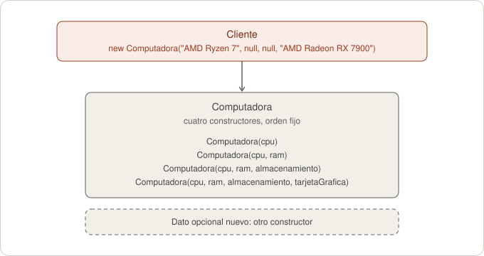
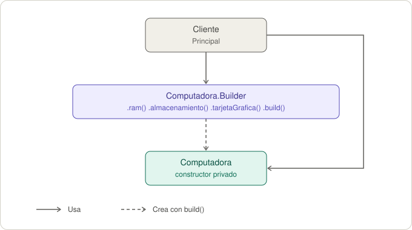
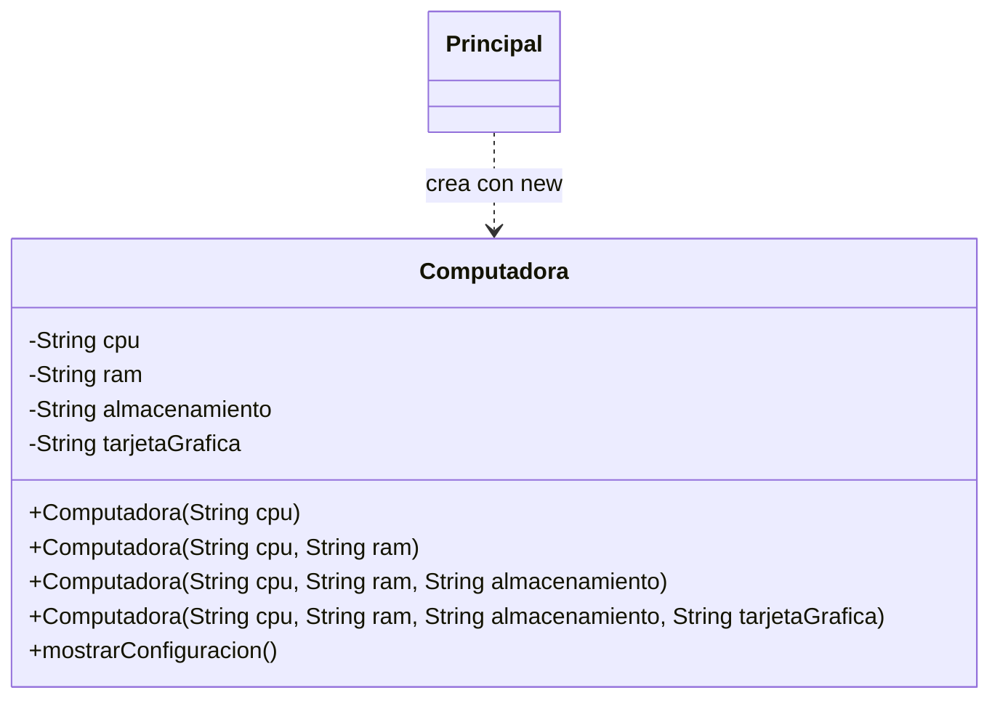
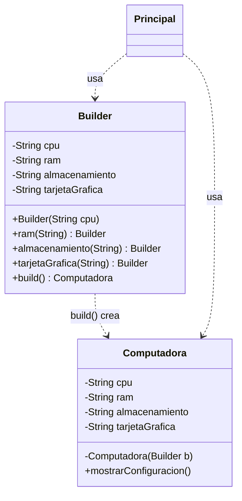

# Patrón 3. Builder

## Objetivo

Reconocer el patrón Builder, ver qué problema resuelve frente a los
constructores con muchos parámetros, y decidir cuándo conviene usarlo.

El problema aparece cuando un objeto tiene varios datos opcionales. La clase
termina con un constructor por cada combinación, cada uno con un parámetro
más que el anterior, lo que se conoce como constructores telescópicos
(Bloch, 2018). Quien los usa debe recordar el orden exacto de los argumentos
y rellenar con `null` los datos que no quiere dar. Si dos datos son del
mismo tipo, como los `String` de una computadora, se pueden intercambiar sin
que el compilador lo note, y el programa corre con un dato equivocado.
Builder arma el objeto paso a paso y pide cada dato por su nombre. Así el
código se lee con claridad, y un descuido de ese tipo se ve en la propia
línea.

## Conocimientos de POO necesarios para la implementación del patrón

Esta variante de Builder es pequeña y no usa herencia ni interfaces, pero sí
se apoya en varias ideas de programación orientada a objetos. Si alguna no
está clara, conviene repasarla antes de seguir, porque los diagramas y el
código que siguen las dan por sabidas. La columna "Dónde se ve en los
diagramas de clases" remite a la sección Diagramas de clases, más abajo.

| Concepto | Dónde se ve en los diagramas de clases | En una frase |
|---|---|---|
| Constructor | Los `Computadora(...)` de la versión sin patrón y el `Builder(String cpu)` de la versión con patrón | Es el método especial que se ejecuta al escribir `new`. Recibe los datos iniciales y los guarda en los atributos |
| Sobrecarga de constructores | Los cuatro `Computadora(...)` de la versión sin patrón | Varios constructores con el mismo nombre y distinta lista de parámetros. Java elige uno según los argumentos que se le pasan. Cuando cada uno agrega un parámetro al anterior, se llaman telescópicos |
| Encapsulación | `-Computadora(Builder b)` en la versión con patrón | Un constructor `private` solo se puede llamar desde dentro de la clase. Así nadie arma una `Computadora` por fuera del `Builder` |
| Atributos `final` | No se dibuja. Se ve en el código, como `private final String cpu` | Un atributo `final` se asigna una sola vez, en el constructor. Después de armada, la computadora ya no cambia |
| Clase anidada estática | `Builder` dentro de `Computadora`. El diagrama las dibuja por separado | Es una clase declarada dentro de otra con `static`. Existe sin necesitar un objeto de la clase externa, por eso se escribe `new Computadora.Builder(...)`, y puede usar el constructor privado de `Computadora` |
| Devolver `this` | `+ram(String) Builder` y los demás métodos del `Builder` | Cada método guarda su dato y devuelve el mismo builder. Eso permite encadenar las llamadas en una sola expresión, como `.ram(...).almacenamiento(...)` |
| `null` | No se dibuja. Aparece en las llamadas de `java/sin-patron/Principal.java` | Es el valor que significa "no hay dato". Un `String` sin dato vale `null`, y usarlo sin revisar puede fallar |

Un constructor normal y un builder hacen el mismo trabajo, que es armar el
objeto. La diferencia es que el constructor recibe todo de golpe y por
posición, y el builder lo recibe por partes y por nombre.

Si estos conceptos todavía te cuestan, es normal. Una buena forma de
revisarlos es leer `java/sin-patron`, que solo usa constructores y `null`, y
después compararlo con `java/con-patron`. En ambas versiones todo ocurre
dentro de `Computadora` y, en la segunda, de su `Builder`.

## Sin el patrón

Esta es la idea en su forma más simple. El cliente arma la computadora con
un constructor que recibe los datos en posiciones fijas, y rellena con
`null` los que no quiere dar. Cada dato opcional nuevo obliga a escribir
otro constructor y a repasar las llamadas que usan `null`.



## El patrón en breve

Builder separa la construcción de un objeto complejo de su representación,
de modo que el mismo proceso pueda producir configuraciones distintas (Gamma
et al., 1994). Arma el objeto paso a paso y lo entrega terminado al final.

En Java, la forma más usada hoy es la variante fluida que describe Bloch
(2018), pensada justo para clases con muchos parámetros opcionales. Esa es
la que se practica aquí. La versión clásica del GoF, con un `Director` que
repite una receta de armado y varios builders que producen representaciones
distintas, está en `referencia-csharp/Program.cs`. Esa versión sí usa una
interfaz y herencia, a diferencia de la variante fluida.

Las piezas de la variante fluida son tres.

- **El producto** (`Computadora`), con un constructor privado y datos que no
  cambian después de creada.
- **El builder** (`Computadora.Builder`), una clase anidada con un método con
  nombre por cada dato opcional. Cada método devuelve el mismo builder, y
  eso permite encadenar las llamadas.
- **`build()`**, que entrega el producto terminado.

Así se ve la idea. El cliente ya no llama a un constructor con todos los
datos. Se los pide al builder por su nombre, uno por uno, y al final
`build()` entrega la computadora terminada.



## Diagramas de clases

Las imágenes anteriores muestran la idea. Aquí están los mismos dos
escenarios como diagramas de clases, con la notación UML que se usa en la
documentación de software.

### Versión sin patrón

En `java/sin-patron`, `Computadora` tiene cuatro constructores, uno por cada
combinación de datos que se quiso soportar. `Principal` crea cada
computadora con `new` y los datos en posiciones fijas.



Todos los datos son `String`, así que el compilador no distingue un orden de
otro. Agregar un dato opcional nuevo obliga a escribir un constructor más.

### Versión con patrón

Con Builder, `Computadora` ya no tiene constructores públicos. Su único
constructor es privado y solo lo llama `build()`. `Principal` pide cada dato
al `Builder` por su nombre y recibe la computadora terminada.



`Builder` es una clase anidada dentro de `Computadora`. El diagrama las
muestra por separado para que se lean mejor.

Compara con la versión sin patrón. `Principal` ya no escribe
`new Computadora(...)` con una lista de datos por posición. Los pide uno a
uno al `Builder`, y la computadora solo se crea al final, en `build()`.

## Cuándo sí y cuándo no

Con dos o tres parámetros, un constructor normal es más claro y más corto.
Escribir un builder ahí es la sobreingeniería de la que habla el README
general. Builder empieza a valer la pena cuando se cumple alguna de estas
situaciones.

- Hay varios datos opcionales, y las combinaciones posibles crecen.
- Hay varios parámetros del mismo tipo, como los `String` de este ejemplo,
  que se pueden intercambiar sin que el compilador lo note.
- Se quiere un objeto que no cambie después de creado y que se pueda
  validar al momento de crearlo.

En otros lenguajes el problema se resuelve de maneras más simples. Por
ejemplo, en JavaScript se pasa un objeto con los campos por nombre, y no
hace falta ninguna clase aparte. En ese caso la idea del patrón está
presente en el lenguaje.

## Práctica en Java (20 min)

Antes de ejecutar cada programa, anota qué crees que va a imprimir.
Comparar tu predicción con el resultado es lo más valioso de la práctica.

1. **Sin patrón.** Lee `java/sin-patron/Computadora.java` y `Principal.java`.
   Fíjate en el caso 3 (`Especial`) y en el caso 4 (`Descuido`). Predice qué
   imprimirá cada uno y ejecútalo. ¿El compilador avisó del descuido?
2. **Con patrón.** Lee `java/con-patron/Computadora.java` y `Principal.java`.
   Predice la salida de los tres casos y ejecútalo. ¿Qué cambió en la forma
   de escribir el caso 3?
3. **Comparar.** En la versión con patrón, ¿qué tendrías que escribir para
   cometer el mismo descuido del caso 4? ¿Se notaría?

### Cómo ejecutar

Desde la terminal, entra a la carpeta de cada versión y compila todo junto.

```
cd java/sin-patron
javac *.java
java Principal
```

Repite con `java/con-patron`. En VS Code, abre una versión a la vez (menú
*File > Open Folder*), porque las dos carpetas tienen clases con el mismo
nombre.

## Qué gana y qué cuesta usar Builder

| Aspecto | Sin patrón | Con patrón |
|---|---|---|
| Cómo se lee la creación | `new Computadora("Intel Core i9", "32 GB DDR5", "1 TB NVMe SSD", "NVIDIA RTX 4080")`. Hay que saber qué es cada posición | Cada dato lleva su nombre: `.ram("32 GB DDR5")` |
| Datos opcionales que no se quieren dar | Se escriben como `null` en su posición | Simplemente no se llama al método |
| Intercambiar dos datos del mismo tipo | Compila y corre, con un dato equivocado | El error se ve en la propia línea, porque el nombre no coincide con el dato |
| Agregar un dato opcional nuevo | Otro constructor, y se repasan las llamadas que usan `null` | Un método nuevo en el `Builder`. Las llamadas existentes no cambian |
| Código en la clase | Una clase con cuatro constructores | La clase, un constructor privado y un `Builder` anidado, bastante más largo |
| Costo | Los errores aparecen en tiempo de ejecución, o nunca | Más código por cada clase, y un objeto intermedio que existe solo para armar el otro |

La última fila es la que decide. El costo es real, porque cada clase con
builder necesita escribir y mantener su `Builder`. Compensa en clases con
muchos parámetros opcionales, y casi nunca en clases pequeñas.

## Árbol de archivos

```
03 - Builder/
├── README.md
├── img/                   diagramas de este README en formato SVG
├── java/
│   ├── sin-patron/        Computadora.java y Principal.java
│   └── con-patron/        Computadora.java (con su Builder) y Principal.java
└── referencia-csharp/     versión original en C#, con el Director y el
                           anti-patrón, solo de consulta
```

Los programas no llevan acentos a propósito, para evitar problemas de
codificación en la consola de Windows.

## Anexos

### Referencia a patrones arquitectónicos

En el [Taller de Arquitecturas de Software](https://github.com/carevalomx69/Taller-de-Arquitecturas-de-Software)
no hay builders. La razón es instructiva. El código del taller está en
JavaScript, y ahí los datos se arman con objetos que llevan el nombre de
cada campo, que es justo lo que el builder logra en Java.

| Práctica | Archivo | Qué hace |
|---|---|---|
| 4. Hexagonal | `04-hexagonal/backend/adapters/apiAdapter.js` | Extrae los datos de la petición por nombre, con `const { userId, title } = req.body`. No importa el orden en que lleguen, y los que no se envían simplemente no están |
| 4. Hexagonal | `04-hexagonal/backend/domain/taskDomain.js` | Entrega sus resultados como objetos con campos nombrados, como `{ data: task, status: 201 }`, en lugar de una lista de valores en posiciones fijas |

Ábrelos y revisa el código. Piensa qué problema de la versión sin patrón de
Java no existe en estos archivos.

### Errores comunes

| Problema | Causa probable | Solución |
|---|---|---|
| `cannot find symbol` al compilar | Se compiló solo un archivo y faltan los demás | Usa `javac *.java` dentro de la carpeta |
| `class X is public, should be declared in a file named X.java` | El nombre del archivo no coincide con el de la clase pública | Cada clase pública va en un archivo con su mismo nombre |
| `javac` no se reconoce como comando | El JDK no está instalado o no está en el PATH | Usa el IDE de tu curso de Java |

## Entregable

Evidencia de que ejecutaste las dos versiones, sin patrón y con patrón.
Puede ser una captura de la salida de cada una o el texto copiado de la
consola, y una línea que diga qué diferencia notaste entre ambas.

Tu predicción no tiene que acertar. Lo que se revisa es que lo ejecutaste y
que observaste la diferencia.

## Referencias

Bloch, J. (2018). *Effective Java* (3.ª ed.). Addison-Wesley.

Gamma, E., Helm, R., Johnson, R. y Vlissides, J. (1994). *Design Patterns:
Elements of Reusable Object-Oriented Software*. Addison-Wesley.
