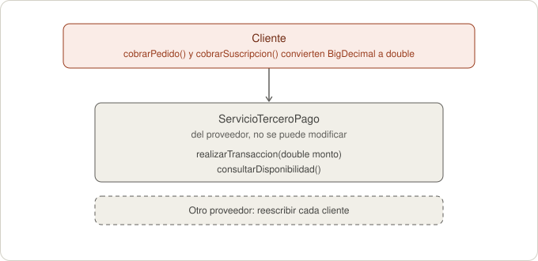
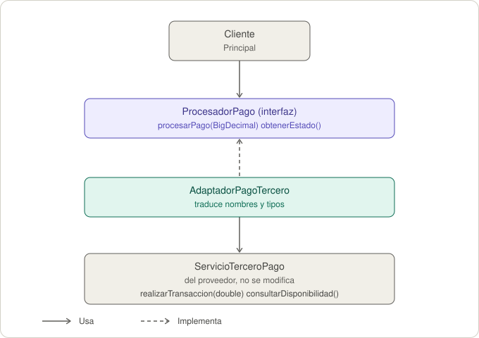
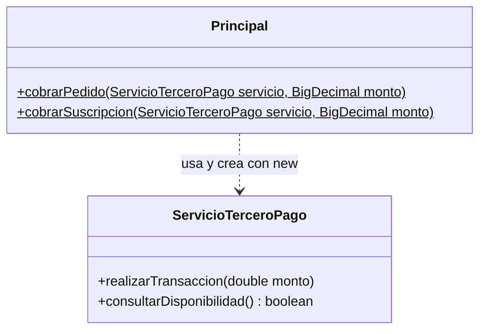
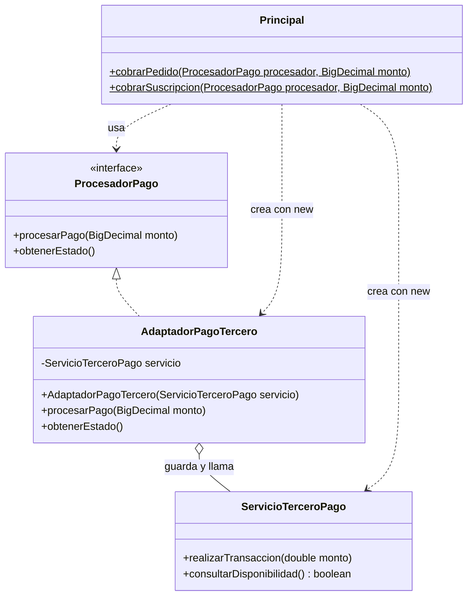

# Patrón 4. Adapter

## Objetivo

Reconocer el patrón Adapter, ver qué problema resuelve cuando el código
depende de una interfaz que no controlas, y decidir cuándo conviene usarlo.

El problema aparece cuando hay código que no se puede o no se debe
modificar, como la biblioteca de un proveedor externo, y que usa nombres o
tipos distintos a los de tu sistema. Si el resto del programa habla
directamente el idioma del proveedor, ese idioma se riega por todo el código
y cambiar de proveedor obliga a reescribirlo. Adapter pone una clase en
medio que traduce. El resto del sistema solo habla con una interfaz propia, y
los detalles del proveedor quedan en un solo lugar.

## Conocimientos de POO necesarios para la implementación del patrón

Adapter es un patrón pequeño, pero se apoya en varias ideas de programación
orientada a objetos. Si alguna no está clara, conviene repasarla antes de
seguir, porque los diagramas y el código que siguen las dan por sabidas. La
columna "Dónde se ve en los diagramas de clases" remite a la sección
Diagramas de clases, más abajo.

| Concepto | Dónde se ve en los diagramas de clases | En una frase |
|---|---|---|
| Interfaz | `ProcesadorPago` | Es un contrato. Lista los métodos que debe tener cualquier procesador de pagos, sin escribir su código. Quien la usa no necesita conocer a quien la implementa |
| Implementación | Flecha punteada de `AdaptadorPagoTercero` hacia `ProcesadorPago` (`implements`) | La clase se compromete a cumplir el contrato y decide cómo hacerlo. Si le falta un método, no compila |
| Composición (en sentido general) | `-ServicioTerceroPago servicio` dentro de `AdaptadorPagoTercero`, y la línea con rombo hueco hacia `ServicioTerceroPago` | El adaptador no hereda del servicio. Guarda una referencia a él en un atributo, y esa referencia es lo que le permite usarlo. En UML estricto este caso se dibuja como agregación, y la razón se explica debajo de la tabla |
| Delegación | `procesarPago()` y `obtenerEstado()` en `AdaptadorPagoTercero` | El adaptador casi no hace el trabajo. Recibe la petición, la traduce y se la pasa al servicio, que es quien la ejecuta |
| Constructor que recibe una dependencia | `AdaptadorPagoTercero(ServicioTerceroPago servicio)` | El adaptador recibe el servicio ya creado y no lo crea él. Por eso `Principal` es quien decide qué servicio y qué adaptador se usan |
| Polimorfismo | No se dibuja | `cobrarPedido()` recibe un `ProcesadorPago`. Al ejecutarse, Java usa el objeto real que recibió, que aquí es el adaptador, aunque la variable esté declarada con el tipo de la interfaz |
| Conversión de tipos | `BigDecimal` en `procesarPago` y `double` en `realizarTransaccion` | `BigDecimal` guarda números decimales con exactitud y `double` los guarda de forma aproximada. Pasar de uno a otro puede perder precisión, y por eso conviene que esa conversión ocurra en un solo lugar. Más abajo hay una subsección sobre `BigDecimal` y sus métodos de conversión |

Sobre el término "composición". En este README se usa en el sentido general
de la programación orientada a objetos, que es guardar una referencia a otro
objeto en un atributo y delegarle trabajo (Gamma et al., 1994). UML es más
estricto. La composición, que se dibuja con rombo relleno, significa que el
todo es dueño de la parte, y que si el todo se elimina sus partes también
(UML Diagrams, s. f.-a). Aquí no ocurre eso, porque `Principal` crea el
`ServicioTerceroPago` y se lo entrega al adaptador por el constructor, así
que el servicio existe aunque el adaptador no. Ese caso es una agregación,
que se dibuja con rombo hueco (UML Diagrams, s. f.-b). El rombo siempre va
del lado del todo, es decir, del adaptador.

Un adaptador y una clase que hereda pueden parecerse, pero hacen cosas
distintas. La herencia reutiliza el código de la clase padre. El adaptador de
este ejemplo reutiliza una clase que ya existe sin tocarla, y solo cambia la forma en que
se le habla.

Si estos conceptos todavía te cuestan, es normal. Una buena forma de
revisarlos es leer `java/sin-patron`, donde `Principal` llama directamente al
servicio del proveedor, y compararlo con `java/con-patron`, donde aparece la
interfaz y el adaptador en medio.

### `BigDecimal`, el tipo del monto

En el ejemplo, el monto del cobro es un `BigDecimal`, y el servicio del
proveedor lo recibe como `double`. Conviene saber qué es cada uno, porque esa
diferencia es justo lo que el adaptador traduce.

`BigDecimal` es una clase de la biblioteca estándar de Java, del paquete
`java.math`, y por eso el código la importa con
`import java.math.BigDecimal;`. La documentación la describe como un número
decimal con signo, inmutable y de precisión arbitraria (Oracle, s. f.). Guarda
los dígitos decimales tal cual, mientras que `double` los guarda en binario y
solo de forma aproximada. La diferencia se nota en un caso simple. En Java,
`0.1 + 0.2` con `double` da `0.30000000000000004`, y con `BigDecimal` da
exactamente `0.3`. Por eso se recomienda evitar `double` cuando se necesitan
resultados exactos, como en los cálculos con dinero (Bloch, 2018). No es un
estándar formal, pero sí la práctica habitual.

Dos detalles de uso importan para el ejemplo.

- **Se crea con texto.** `new BigDecimal("125.50")` guarda exactamente 125.50.
  En cambio, `new BigDecimal(0.1)`, con un `double`, arrastra la aproximación
  del `double` y guarda `0.1000000000000000055511151231257827021181583404541015625`.
  La documentación recomienda el constructor con texto por esa razón (Oracle,
  s. f.).
- **No se modifica.** Un `BigDecimal` es inmutable. Las operaciones, como
  `add` o `movePointRight`, devuelven un objeto nuevo y dejan el original
  igual.

Para pasar un `BigDecimal` a otro tipo, la clase ofrece varios métodos de
conversión. Esta tabla muestra los más usados, con el valor `125.50`.

| Método | Qué devuelve | Con `125.50` |
|---|---|---|
| `doubleValue()` | Un `double`, que es una aproximación | `125.5` |
| `intValue()` | Un `int`, y descarta la parte decimal sin avisar | `125` |
| `longValue()` | Un `long`, igual que el anterior | `125` |
| `intValueExact()` | Un `int`, pero lanza `ArithmeticException` si perdería información | Lanza la excepción, porque `.50` se perdería. Con `12550.00` devuelve `12550` |
| `toPlainString()` | Texto, sin notación científica | `"125.50"` |
| `movePointRight(2)` | Otro `BigDecimal` con el punto decimal corrido dos lugares. Sirve para pasar a centavos | `12550` |

En el adaptador de la práctica se usa `doubleValue()`, porque el servicio del
proveedor pide un `double` y no hay otra forma de dárselo. Esa conversión
puede perder precisión, y es una razón más para que ocurra en un solo
lugar. Más abajo, en la sección "Qué gana y qué cuesta", se muestra un
fragmento ilustrativo, que no forma parte de los archivos de la práctica, de
un hipotético segundo proveedor que recibe centavos enteros. Ahí se usa otra
combinación, `movePointRight(2).intValueExact()`. Si el monto trajera
decimales de más, por ejemplo `125.505`, esa combinación lanza una excepción
en lugar de perder el dato en silencio.

## Sin el patrón

Esta es la idea en su forma más simple. Cada función que cobra llama
directamente al servicio del proveedor, convierte el monto de `BigDecimal` a
`double` por su cuenta y usa los nombres del proveedor. El conocimiento de
cómo se habla con el proveedor está repartido entre todas las funciones que
cobran, y cambiar de proveedor obliga a reescribirlas todas.



## El patrón en breve

Adapter convierte la interfaz de una clase en otra que el cliente espera,
para que clases con interfaces incompatibles puedan trabajar juntas (Gamma
et al., 1994). Es como un adaptador de corriente. El enchufe de la pared no
cambia, ni tampoco tu cargador, y el adaptador se encarga de que encajen.

En el ejemplo de la práctica, un sistema de cobros usa el servicio de un
proveedor de pagos. Las piezas son cuatro.

- **Interfaz objetivo** (`ProcesadorPago`). Lo que nuestro sistema quiere
  usar, con nuestros nombres y nuestros tipos.
- **Clase adaptada** (`ServicioTerceroPago`). El servicio del proveedor, con
  `realizarTransaccion(double)`. No se puede modificar.
- **Adaptador** (`AdaptadorPagoTercero`). Cumple la interfaz objetivo y por
  dentro llama a la clase adaptada, traduciendo nombres y tipos.
- **Cliente.** El código que cobra y que solo conoce la interfaz objetivo.

Así se ve la idea. El cliente ya no habla con el proveedor. Habla con la
interfaz propia, y el adaptador, que cumple esa interfaz, traduce cada
petición hacia el servicio del proveedor.



## Diagramas de clases

Las imágenes anteriores muestran la idea. Aquí están los mismos dos
escenarios como diagramas de clases, con la notación UML que se usa en la
documentación de software.

### Versión sin patrón

En `java/sin-patron` no hay interfaz ni adaptador. `Principal` tiene dos
funciones que cobran, y cada una recibe el `ServicioTerceroPago`, convierte
el monto y llama a sus métodos directamente.



Las dos funciones repiten la conversión de `BigDecimal` a `double` y las
llamadas con los nombres del proveedor. Si el proveedor cambia, hay que
reescribir las dos.

### Versión con patrón

Con Adapter, las funciones que cobran ya no conocen al `ServicioTerceroPago`.
Reciben un `ProcesadorPago`, que es la interfaz del sistema.
`AdaptadorPagoTercero` la implementa y guarda una referencia al servicio del
proveedor, al que traduce cada llamada.



Compara con la versión sin patrón. `cobrarPedido()` y `cobrarSuscripcion()`
ya no conocen al proveedor, solo a `ProcesadorPago`. El único lugar que
conoce al servicio y a su adaptador es el `main`, que es donde se arma todo.

## Cuándo sí y cuándo no

Si usas la biblioteca del proveedor en un solo lugar y no esperas cambiarla,
llamarla directamente es más simple. Un adaptador ahí es la sobreingeniería
de la que habla el README general. Adapter empieza a valer la pena cuando se
cumple alguna de estas situaciones.

- La misma biblioteca externa se usa en varias partes del programa.
- Es probable que el proveedor cambie, o que haya que soportar más de uno.
- Quieres proteger tu lógica de negocio de los detalles de una tecnología,
  por ejemplo para poder probarla sin el proveedor real.

Esta última idea es la base de la arquitectura hexagonal, que Cockburn
(2005) llama de "puertos y adaptadores". Los adaptadores que ya viste en el
Taller de Arquitecturas son este mismo patrón aplicado a toda una capa del
sistema.

## Práctica en Java (20 min)

Antes de ejecutar cada programa, anota qué crees que va a imprimir.
Comparar tu predicción con el resultado es lo más valioso de la práctica.

1. **Sin patrón.** Lee `java/sin-patron/Principal.java`. Fíjate en cuántas
   veces aparece `realizarTransaccion` y `doubleValue()`. Predice la salida
   y ejecútalo.
2. **Con patrón.** Lee `java/con-patron/AdaptadorPagoTercero.java` y
   `Principal.java`. Fíjate qué conoce ahora `cobrarPedido`. Predice qué
   líneas nuevas aparecerán en la salida y ejecútalo.
3. **Comparar.** Si el proveedor se reemplazara por otro con nombres
   distintos, ¿qué archivos habría que modificar en cada versión?

### Cómo ejecutar

Desde la terminal, entra a la carpeta de cada versión y compila todo junto.

```
cd java/sin-patron
javac *.java
java Principal
```

Repite con `java/con-patron`. En VS Code, abre una versión a la vez (menú
*File > Open Folder*), porque las dos carpetas tienen clases con el mismo
nombre.

## Qué gana y qué cuesta usar Adapter

| Aspecto | Sin patrón | Con patrón |
|---|---|---|
| Quién conoce la API del proveedor | `cobrarPedido` y `cobrarSuscripcion`, cada una por su cuenta | Solo `AdaptadorPagoTercero` |
| Dónde se convierte `BigDecimal` a `double` | En cada función que cobra | En un solo método del adaptador |
| Lo que ve el cliente | Nombres y tipos del proveedor | Nombres y tipos de nuestro sistema |
| Cambiar de proveedor | Reescribir todas las funciones que cobran | Escribir otro adaptador y cambiar las líneas que crean el servicio |
| Clases en total | 2 | 4 |
| Costo | Ninguno al inicio, pero el idioma del proveedor se riega por el código | Una interfaz y una clase más, y una llamada extra por cada operación |

La última fila es la que decide. Con una sola función y un proveedor
estable, el adaptador es un trámite sin beneficio. Compensa cuando el
proveedor se usa en muchos lugares o puede cambiar.

Así se vería un segundo proveedor, con otros nombres y con el monto en
centavos enteros. El cliente no cambia.

```java
public class ServicioPagoAlterno {
    public void pagar(int centavos) { /* ... */ }
    public boolean estaEnLinea()    { return true; }
}

public class AdaptadorPagoAlterno implements ProcesadorPago {
    private final ServicioPagoAlterno servicio;

    public AdaptadorPagoAlterno(ServicioPagoAlterno servicio) { this.servicio = servicio; }

    @Override
    public void procesarPago(BigDecimal monto) {
        servicio.pagar(monto.movePointRight(2).intValueExact());
    }

    @Override
    public void obtenerEstado() {
        if (servicio.estaEnLinea()) System.out.println("El servicio esta disponible.");
    }
}
```

Aquí `movePointRight(2)` corre el punto decimal dos lugares, y `125.50` pasa a
`12550.00`. Después `intValueExact()` lo convierte a entero y falla si
quedaran decimales, en lugar de descartarlos.

## Árbol de archivos

```
04 - Adapter/
├── README.md
├── img/                   diagramas de este README en formato SVG
├── java/
│   ├── sin-patron/        ServicioTerceroPago.java y Principal.java
│   └── con-patron/        ServicioTerceroPago.java, ProcesadorPago.java,
│                          AdaptadorPagoTercero.java y Principal.java
└── referencia-csharp/     versión original en C#, solo de consulta
```

El archivo `ServicioTerceroPago.java` es el mismo en las dos carpetas.
Representa código ajeno, que no se toca.

Los programas no llevan acentos a propósito, para evitar problemas de
codificación en la consola de Windows.

## Anexos

### Referencia a patrones arquitectónicos

Aquí el patrón sí aparece, y con la misma función. En el
[Taller de Arquitecturas de Software](https://github.com/carevalomx69/Taller-de-Arquitecturas-de-Software)
la lógica de las tareas espera un repositorio con tres operaciones, y cada
tecnología de base de datos tiene un adaptador que las cumple.

| Práctica | Archivo | Qué hace |
|---|---|---|
| 4. Hexagonal | `04-hexagonal/backend/adapters/dbAdapter.js` | Adaptador para MySQL. Cumple `findTasksByUserId`, `createTask` y `updateTaskStatus`, que es lo que el dominio espera. También traduce el error propio de MySQL `ER_DUP_ENTRY` al código genérico `DUPLICATE_USERNAME` |
| 9. Serverless | `09-serverless/adapters/postgresAdapter.js` | Adaptador para Postgres. Ofrece las mismas tres operaciones de tareas, con otra tecnología por dentro |
| 4 y 9 | `domain/taskDomain.js` | Es el mismo código en las dos prácticas. Solo cambia el comentario inicial. El dominio no se entera de que la base de datos cambió |

El Taller sigue la misma estructura del ejemplo. El dominio es el cliente,
el repositorio es la interfaz objetivo y cada adaptador absorbe las
diferencias de su tecnología. Ábrelos y revisa el código. Compara los
métodos de los dos adaptadores y busca en qué se parecen y en qué no.

### Errores comunes

| Problema | Causa probable | Solución |
|---|---|---|
| `cannot find symbol` al compilar | Se compiló solo un archivo y faltan los demás | Usa `javac *.java` dentro de la carpeta |
| `class X is public, should be declared in a file named X.java` | El nombre del archivo no coincide con el de la clase pública | Cada clase pública va en un archivo con su mismo nombre |
| `javac` no se reconoce como comando | El JDK no está instalado o no está en el PATH | Usa el IDE de tu curso de Java |

## Entregable

Evidencia de que ejecutaste las dos versiones, sin patrón y con patrón.
Puede ser una captura de la salida de cada una o el texto copiado de la
consola, y una línea que diga qué diferencia notaste entre ambas.

Tu predicción no tiene que acertar. Lo que se revisa es que lo ejecutaste y
que observaste la diferencia.

## Referencias

Bloch, J. (2018). *Effective Java* (3.ª ed.). Addison-Wesley.

Cockburn, A. (2005). *The Hexagonal (Ports & Adapters) Architecture*.
https://alistair.cockburn.us/hexagonal-architecture/

Gamma, E., Helm, R., Johnson, R. y Vlissides, J. (1994). *Design Patterns:
Elements of Reusable Object-Oriented Software*. Addison-Wesley.

Oracle. (s. f.). *BigDecimal* (Java SE 21 y JDK 21). Documentación de la API.
https://docs.oracle.com/en/java/javase/21/docs/api/java.base/java/math/BigDecimal.html

UML Diagrams. (s. f.-a). *UML composition*.
https://www.uml-diagrams.org/composition.html

UML Diagrams. (s. f.-b). *UML aggregation*.
https://www.uml-diagrams.org/aggregation.html
