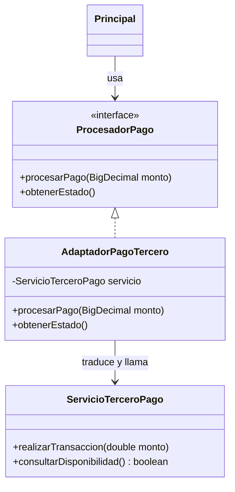

# Patrón 4. Adapter

## Objetivo

Reconocer el patrón Adapter, ver qué problema resuelve cuando el código
depende de una interfaz que no controlas, y decidir cuándo conviene usarlo.

## El patrón en breve

Adapter convierte la interfaz de una clase en otra que el cliente espera,
para que clases con interfaces incompatibles puedan trabajar juntas (Gamma
et al., 1994). Es como un adaptador de corriente. El enchufe de la pared no
cambia, ni tampoco tu cargador, y el adaptador se encarga de que encajen.

El problema que resuelve es este. Hay código que no se puede o no se debe
modificar, como una biblioteca de un proveedor externo, y que usa nombres o
tipos distintos a los de tu sistema. Si el resto del programa habla
directamente el idioma del proveedor, ese idioma se riega por todo el
código y cambiar de proveedor obliga a reescribirlo.

En el ejemplo de la práctica, un sistema de cobros usa el servicio de un
proveedor de pagos. Las piezas son cuatro.

- **Interfaz objetivo** (`ProcesadorPago`). Lo que nuestro sistema quiere
  usar, con nuestros nombres y nuestros tipos.
- **Clase adaptada** (`ServicioTerceroPago`). El servicio del proveedor, con
  `realizarTransaccion(double)`. No se puede modificar.
- **Adaptador** (`AdaptadorPagoTercero`). Cumple la interfaz objetivo y por
  dentro llama a la clase adaptada, traduciendo nombres y tipos.
- **Cliente.** El código que cobra y que solo conoce la interfaz objetivo.



## Cuándo sí y cuándo no

Si usas la biblioteca del proveedor en un solo lugar y no esperas cambiarla,
llamarla directamente es más simple. Un adaptador ahí es la sobreingeniería
de la que habla el README general. Adapter empieza a valer la pena cuando se
cumple alguna de estas situaciones.

- La misma biblioteca externa se usa en varias partes del programa.
- Es probable que el proveedor cambie, o que haya que soportar más de uno.
- Quieres proteger tu lógica de negocio de los detalles de una tecnología,
  por ejemplo para poder probarla sin el proveedor real.

Esta última idea es la base de la arquitectura hexagonal, que Cockburn
(2005) llama de "puertos y adaptadores". Los adaptadores que ya viste en el
Taller de Arquitecturas son este mismo patrón aplicado a toda una capa del
sistema.

## Archivos

```
04 - Adapter/
├── README.md
├── java/
│   ├── sin-patron/        ServicioTerceroPago.java y Principal.java
│   └── con-patron/        ServicioTerceroPago.java, ProcesadorPago.java,
│                          AdaptadorPagoTercero.java y Principal.java
└── referencia-csharp/     versión original en C#, solo de consulta
```

El archivo `ServicioTerceroPago.java` es el mismo en las dos carpetas.
Representa código ajeno, que no se toca.

Los programas no llevan acentos a propósito, para evitar problemas de
codificación en la consola de Windows.

## Práctica en Java (20 min)

Antes de ejecutar cada programa, anota qué crees que va a imprimir.
Comparar tu predicción con el resultado es lo más valioso de la práctica.

1. **Sin patrón.** Lee `java/sin-patron/Principal.java`. Fíjate en cuántas
   veces aparece `realizarTransaccion` y `doubleValue()`. Predice la salida
   y ejecútalo.
2. **Con patrón.** Lee `java/con-patron/AdaptadorPagoTercero.java` y
   `Principal.java`. Fíjate qué conoce ahora `cobrarPedido`. Predice qué
   líneas nuevas aparecerán en la salida y ejecútalo.
3. **Comparar.** Si el proveedor se reemplazara por otro con nombres
   distintos, ¿qué archivos habría que modificar en cada versión?

### Cómo ejecutar

Desde la terminal, entra a la carpeta de cada versión y compila todo junto.

```
cd java/sin-patron
javac *.java
java Principal
```

Repite con `java/con-patron`. En VS Code, abre una versión a la vez (menú
*File > Open Folder*), porque las dos carpetas tienen clases con el mismo
nombre.

## Qué gana y qué cuesta usar Adapter

| Aspecto | Sin patrón | Con patrón |
|---|---|---|
| Quién conoce la API del proveedor | `cobrarPedido` y `cobrarSuscripcion`, cada una por su cuenta | Solo `AdaptadorPagoTercero` |
| Dónde se convierte `BigDecimal` a `double` | En cada función que cobra | En un solo método del adaptador |
| Lo que ve el cliente | Nombres y tipos del proveedor | Nombres y tipos de nuestro sistema |
| Cambiar de proveedor | Reescribir todas las funciones que cobran | Escribir otro adaptador y cambiar las líneas que crean el servicio |
| Clases en total | 2 | 4 |
| Costo | Ninguno al inicio, pero el idioma del proveedor se riega por el código | Una interfaz y una clase más, y una llamada extra por cada operación |

La última fila es la que decide. Con una sola función y un proveedor
estable, el adaptador es un trámite sin beneficio. Compensa cuando el
proveedor se usa en muchos lugares o puede cambiar.

Así se vería un segundo proveedor, con otros nombres y con el monto en
centavos enteros. El cliente no cambia.

```java
public class ServicioPagoAlterno {
    public void pagar(int centavos) { /* ... */ }
    public boolean estaEnLinea()    { return true; }
}

public class AdaptadorPagoAlterno implements ProcesadorPago {
    private final ServicioPagoAlterno servicio;

    public AdaptadorPagoAlterno(ServicioPagoAlterno servicio) { this.servicio = servicio; }

    @Override
    public void procesarPago(BigDecimal monto) {
        servicio.pagar(monto.movePointRight(2).intValueExact());
    }

    @Override
    public void obtenerEstado() {
        if (servicio.estaEnLinea()) System.out.println("El servicio esta disponible.");
    }
}
```

## Patrones usados en el taller de arquitecturas (sin haberlos conocido aun)

Aquí el patrón sí aparece, y con la misma función. En el
[Taller de Arquitecturas de Software](https://github.com/carevalomx69/Taller-de-Arquitecturas-de-Software)
la lógica de las tareas espera un repositorio con tres operaciones, y cada
tecnología de base de datos tiene un adaptador que las cumple.

| Práctica | Archivo | Qué hace |
|---|---|---|
| 4. Hexagonal | `04-hexagonal/backend/adapters/dbAdapter.js` | Adaptador para MySQL. Cumple `findTasksByUserId`, `createTask` y `updateTaskStatus`, que es lo que el dominio espera. También traduce el error propio de MySQL `ER_DUP_ENTRY` al código genérico `DUPLICATE_USERNAME` |
| 9. Serverless | `09-serverless/adapters/postgresAdapter.js` | Adaptador para Postgres. Ofrece las mismas tres operaciones de tareas, con otra tecnología por dentro |
| 4 y 9 | `domain/taskDomain.js` | Es el mismo código en las dos prácticas. Solo cambia el comentario inicial. El dominio no se entera de que la base de datos cambió |

El Taller sigue la misma estructura del ejemplo. El dominio es el cliente,
el repositorio es la interfaz objetivo y cada adaptador absorbe las
diferencias de su tecnología. Ábrelos y revisa el código. Compara los
métodos de los dos adaptadores y busca en qué se parecen y en qué no.

## Errores comunes

| Problema | Causa probable | Solución |
|---|---|---|
| `cannot find symbol` al compilar | Se compiló solo un archivo y faltan los demás | Usa `javac *.java` dentro de la carpeta |
| `class X is public, should be declared in a file named X.java` | El nombre del archivo no coincide con el de la clase pública | Cada clase pública va en un archivo con su mismo nombre |
| `javac` no se reconoce como comando | El JDK no está instalado o no está en el PATH | Usa el IDE de tu curso de Java |

## Entregable

Evidencia de que ejecutaste las dos versiones, sin patrón y con patrón.
Puede ser una captura de la salida de cada una o el texto copiado de la
consola, y una línea que diga qué diferencia notaste entre ambas.

Tu predicción no tiene que acertar. Lo que se revisa es que lo ejecutaste y
que observaste la diferencia.

## Referencias

Cockburn, A. (2005). *The Hexagonal (Ports & Adapters) Architecture*.
https://alistair.cockburn.us/hexagonal-architecture/

Gamma, E., Helm, R., Johnson, R. y Vlissides, J. (1994). *Design Patterns:
Elements of Reusable Object-Oriented Software*. Addison-Wesley.
