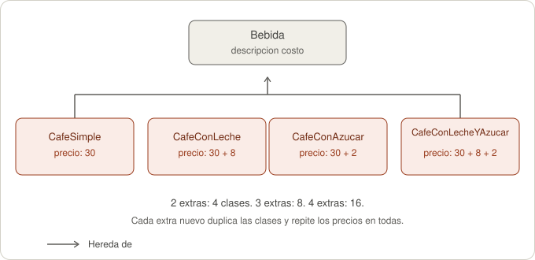
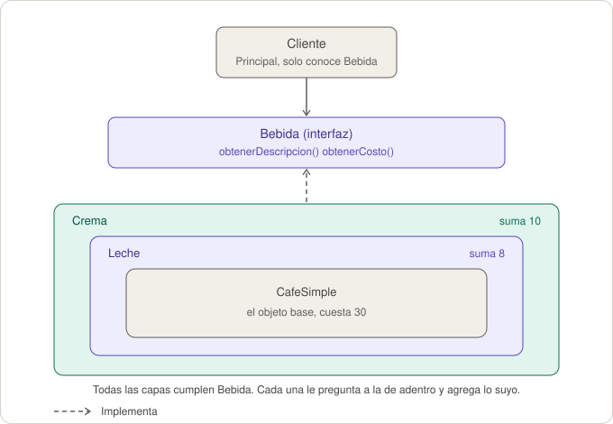
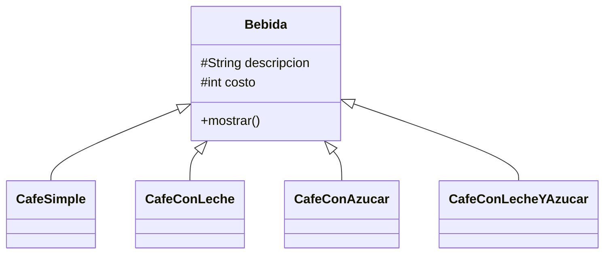
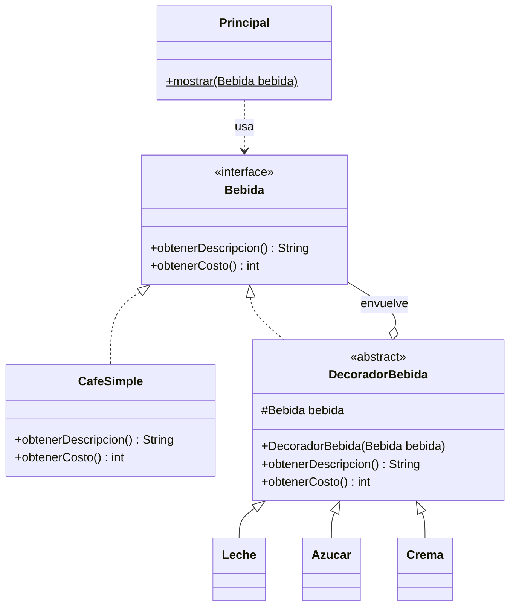

# Patrón 5. Decorator

## Objetivo

Reconocer el patrón Decorator, ver qué problema resuelve cuando los extras de
un objeto se pueden combinar de muchas formas, y decidir cuándo conviene
usarlo.

El problema aparece cuando un objeto puede llevar opciones adicionales y
cualquier combinación de ellas es válida. Si se resuelve con herencia, hace
falta una clase por cada combinación. Con dos extras son cuatro clases, con
tres son ocho, y cada extra nuevo duplica la cantidad. Decorator evita eso
con una clase por extra. Cada extra envuelve al objeto, y los extras se
combinan al armar el objeto, en el orden y la cantidad que se quiera.

## Conocimientos de POO necesarios para la implementación del patrón

Decorator se apoya en varias ideas de programación orientada a objetos. Si
alguna no está clara, conviene repasarla antes de seguir, porque los
diagramas y el código que siguen las dan por sabidas. La columna "Dónde se ve
en los diagramas de clases" remite a la sección Diagramas de clases, más
abajo.

| Concepto | Dónde se ve en los diagramas de clases | En una frase |
|---|---|---|
| Interfaz | `Bebida` | Es un contrato. Lista los métodos que debe tener cualquier bebida, sin escribir su código. Quien la usa no necesita saber si recibe un café solo o uno con extras |
| Implementación | Flechas punteadas hacia `Bebida` (`implements`) | `CafeSimple` y `DecoradorBebida` se comprometen a cumplir el contrato. Si les falta un método, no compilan |
| Clase abstracta | `DecoradorBebida` | Es una clase que no se puede crear con `new`. Sirve de base para otras y resuelve lo que todas comparten, que aquí es guardar la bebida envuelta y pasarle las preguntas |
| Herencia | `Leche`, `Azucar` y `Crema` hacia `DecoradorBebida` (`extends`) | Cada extra recibe de `DecoradorBebida` lo que ya está resuelto y solo escribe lo que cambia, que es su descripción y su precio |
| Composición (en sentido general) | `-Bebida bebida` dentro de `DecoradorBebida`, y la línea con rombo hueco llamada `envuelve` | El decorador guarda una referencia a otra bebida en un atributo. Esa referencia es lo que le permite envolverla. En UML estricto este caso se dibuja como agregación, y la razón se explica debajo de la tabla |
| Delegación | `bebida.obtenerCosto()` dentro de cada decorador | El decorador no calcula el costo completo. Le pregunta a la bebida que envuelve y le suma lo suyo |
| Constructor que recibe una dependencia | `Leche(Bebida bebida)` | El decorador recibe la bebida ya creada y no la crea él. Por eso `Principal` decide qué se envuelve y en qué orden |
| Polimorfismo | No se dibuja | `mostrar()` recibe una `Bebida`. Al ejecutarse, Java usa el objeto real que recibió, ya sea un `CafeSimple` o tres decoradores apilados, aunque la variable esté declarada con el tipo de la interfaz |

Sobre el término "composición". En este README se usa en el sentido general
de la programación orientada a objetos, que es guardar una referencia a otro
objeto en un atributo y delegarle trabajo (Gamma et al., 1994). UML es más
estricto. La composición, que se dibuja con rombo relleno, significa que el
todo es dueño de la parte, y que si el todo se elimina sus partes también
(UML Diagrams, s. f.-a). Aquí no ocurre eso, porque `Principal` crea la
bebida y se la entrega al decorador por el constructor, así que la bebida
envuelta existe aunque el decorador no. Ese caso es una agregación, que se
dibuja con rombo hueco (UML Diagrams, s. f.-b). El rombo va del lado del
todo, es decir, del decorador.

Hay dos cosas fáciles de confundir. Primero, un decorador es una `Bebida` y
además tiene una `Bebida`. Lo primero (la herencia o implementación) permite
usarlo en cualquier lugar donde se espera una bebida. Lo segundo (la
composición) es lo que le permite envolver a otra. Sin las dos cosas juntas el
patrón no funciona. Segundo, Adapter y Decorator también se parecen, porque
los dos envuelven un objeto. La diferencia es el propósito. Adapter cambia la
interfaz para que dos piezas encajen, y Decorator conserva la interfaz y
agrega comportamiento (Gamma et al., 1994).

Si estos conceptos todavía te cuestan, es normal. Una buena forma de
revisarlos es leer `java/sin-patron`, donde cada combinación es una clase, y
compararlo con `java/con-patron`, donde aparecen la interfaz y los
decoradores.

## Sin el patrón

Esta es la idea en su forma más simple. Hay una clase base `Bebida` y cada
combinación de extras es una subclase. El precio del café y el de cada extra
se repiten en todas las clases donde aparecen, y si se agrega un extra nuevo
hay que escribir una clase por cada combinación que lo incluya.



## El patrón en breve

Decorator agrega responsabilidades a un objeto de forma dinámica. Los
decoradores son una alternativa flexible a la herencia para extender el
comportamiento (Gamma et al., 1994). Es como vestirse con capas. La persona
es la misma, y cada prenda agrega algo (abrigo, bufanda) sin cambiar quién es.
Se pueden poner más o menos prendas según el día.

En el ejemplo de la práctica, una cafetería calcula el precio y la
descripción de una bebida. Las piezas son cuatro.

- **Interfaz** (`Bebida`). Lo que todos cumplen, tanto el café como los
  extras. El cliente solo conoce esta interfaz.
- **Objeto base** (`CafeSimple`). La bebida que se va a decorar. No sabe nada
  de los extras.
- **Decorador base** (`DecoradorBebida`). Cumple la interfaz y guarda la
  bebida que envuelve. Por defecto le pasa cada pregunta tal cual.
- **Decoradores concretos** (`Leche`, `Azucar` y `Crema`). Cada uno envuelve
  una bebida, le pregunta lo suyo a la de adentro y le suma su descripción y
  su precio.

Así se ve la idea. El cliente ya no elige entre clases de combinaciones.
Arma la bebida por capas, y cada capa cumple la misma interfaz que la de
adentro.



## Diagramas de clases

Las imágenes anteriores muestran la idea. Aquí están los mismos dos
escenarios como diagramas de clases, con la notación UML que se usa en la
documentación de software.

### Versión sin patrón

En `java/sin-patron`, `Bebida` es una clase normal y cada combinación es una
subclase que escribe en su constructor la descripción y el costo completos.



Para ofrecer también crema habría que agregar cuatro clases más
(`CafeConCrema`, `CafeConLecheYCrema`, `CafeConAzucarYCrema` y
`CafeConLecheAzucarYCrema`).

### Versión con patrón

Con Decorator, `Bebida` es una interfaz. `CafeSimple` y `DecoradorBebida` la
implementan, y `DecoradorBebida` además guarda una referencia a otra
`Bebida`. Cada extra hereda de `DecoradorBebida`.



Compara con la versión sin patrón. Para agregar crema solo se escribió
`Crema`, una clase que no obliga a tocar ninguna de las otras. La línea
`envuelve` es la que hace posible apilar capas, porque cada decorador guarda
una `Bebida`, y esa `Bebida` puede ser a su vez otro decorador.

## Cuándo sí y cuándo no

Si los extras son pocos y fijos, por ejemplo una sola variante, una clase o
un `if` es más simple. Un decorador ahí es la sobreingeniería de la que habla
el README general. Decorator empieza a valer la pena cuando se cumple alguna
de estas situaciones.

- Los extras se pueden combinar libremente, y las combinaciones posibles
  crecen más rápido que las ganas de escribirlas como clases.
- Los extras se agregan o se quitan mientras el programa corre, según lo que
  pida el usuario.
- No se puede o no se debe modificar la clase base, y aun así se quiere
  agregarle comportamiento.

También tiene costos. Un diseño con decoradores produce muchos objetos
pequeños y parecidos, que cuestan más trabajo de entender y de depurar que
una sola clase (Gamma et al., 1994). Además, el resultado puede depender del orden de las capas. En este ejemplo el orden
solo cambia la descripción (`con crema, con leche` o `con leche, con crema`),
pero en otros casos, como aplicar un descuento antes o después de un
impuesto, cambia el resultado.

Un ejemplo real en la propia biblioteca de Java son los flujos de entrada.
`BufferedReader` es un `Reader` que recibe otro `Reader` y le agrega un
búfer de lectura (Oracle, s. f.), de modo que
`new BufferedReader(new FileReader("datos.txt"))` es el mismo patrón que
`new Leche(new CafeSimple())`.

## Práctica en Java (20 min)

Antes de ejecutar cada programa, anota qué crees que va a imprimir.
Comparar tu predicción con el resultado es lo más valioso de la práctica.

1. **Sin patrón.** Lee las clases de `java/sin-patron`. Fíjate cuántas
   clases hay y cuántas veces aparece el número 30. Predice la salida y
   ejecútalo.
2. **Con patrón.** Lee `java/con-patron/DecoradorBebida.java`, `Leche.java` y
   `Principal.java`. Fíjate en cuántas veces aparece el precio del café
   y qué clase conoce el precio de la leche. Predice cuál será el costo de la
   bebida `especial` del `main` y ejecútalo.
3. **Comparar.** Si se agregara canela como extra, ¿qué archivos habría que
   escribir o modificar en cada versión? ¿Y si el precio de la leche cambiara?

### Cómo ejecutar

Desde la terminal, entra a la carpeta de cada versión y compila todo junto.

```
cd java/sin-patron
javac *.java
java Principal
```

Repite con `java/con-patron`. En VS Code, abre una versión a la vez (menú
*File > Open Folder*), porque las dos carpetas tienen clases con el mismo
nombre.

## Qué gana y qué cuesta usar Decorator

| Aspecto | Sin patrón | Con patrón |
|---|---|---|
| Clases para café, leche y azúcar | 5 (la base y cuatro subclases, una por combinación) | 5 (interfaz, café, decorador base y dos decoradores) |
| Clases al agregar crema | 4 nuevas, una por cada combinación con crema, para un total de 9 | 1 nueva (`Crema`), para un total de 6 |
| Dónde está el precio de la leche | Repetido en cada clase que incluye leche | Solo en `Leche` |
| Cuándo se decide la combinación | Al escribir el código, eligiendo la clase | Al ejecutar, envolviendo el objeto |
| Combinaciones que se pueden pedir | Solo las que alguien escribió como clase | Cualquiera, incluso repetir un extra (doble leche) |
| Costo | Ninguno al inicio, pero las clases se duplican con cada extra | Más piezas desde el principio, y un objeto armado con capas es más difícil de seguir al depurar |

Con dos extras no hay ahorro, porque las dos versiones tienen cinco clases.
La ventaja aparece cuando los extras crecen, como muestra la segunda fila, y
es la que decide.

## Árbol de archivos

```
05 - Decorator/
├── README.md
├── img/                   diagramas de este README en formato SVG
├── java/
│   ├── sin-patron/        Bebida.java, CafeSimple.java, CafeConLeche.java,
│   │                      CafeConAzucar.java, CafeConLecheYAzucar.java
│   │                      y Principal.java
│   └── con-patron/        Bebida.java, CafeSimple.java, DecoradorBebida.java,
│                          Leche.java, Azucar.java, Crema.java y Principal.java
└── referencia-csharp/     versión original en C#, solo de consulta
```

Los programas no llevan acentos a propósito, para evitar problemas de
codificación en la consola de Windows. Los costos son pesos enteros (`int`)
para no mezclar esta práctica con el tema de precisión decimal que se vio en
Adapter.

## Anexos

### Referencia a patrones arquitectónicos

En el Taller de Arquitecturas de Software no hay un Decorator literal, es
decir, no hay una clase que implemente una interfaz y envuelva a otro objeto
de esa misma interfaz. Lo más cercano son las capas de Express que se apilan
antes de llegar a las rutas, por ejemplo en
[`03-capas-mvc/backend/server.js`](https://github.com/carevalomx69/Taller-de-Arquitecturas-de-Software).

| Práctica | Archivo | Qué hace |
|---|---|---|
| 3. Capas / MVC | `03-capas-mvc/backend/server.js` | `app.use(cors())` y `app.use(express.json())` agregan comportamiento a cada petición (permitir otros orígenes, leer el cuerpo como JSON) antes de que llegue a la ruta. El código de las rutas no sabe que eso ocurre |
| 4. Hexagonal | `04-hexagonal/backend/adapters/apiAdapter.js` | Aplica las mismas dos capas dentro de `createApiAdapter` |

El parecido es la idea de agregar comportamiento por capas sin tocar el
código de las rutas. Pero no es el mismo patrón. En Decorator cada capa es un
objeto que cumple la misma interfaz que el objeto envuelto y lo envuelve. En
Express, cada capa es una función que recibe la petición y decide si pasa el
control a la siguiente. Eso se parece más a una cadena de pasos (el patrón
Chain of Responsibility, Gamma et al., 1994) que a un Decorator. Ábrelos, mira el orden de las
líneas y piensa qué pasaría si se invirtiera.

### Errores comunes

| Problema | Causa probable | Solución |
|---|---|---|
| `cannot find symbol` al compilar | Se compiló solo un archivo y faltan los demás | Usa `javac *.java` dentro de la carpeta |
| `class X is public, should be declared in a file named X.java` | El nombre del archivo no coincide con el de la clase pública | Cada clase pública va en un archivo con su mismo nombre |
| `javac` no se reconoce como comando | El JDK no está instalado o no está en el PATH | Usa el IDE de tu curso de Java |
| Se ve `Costo` sin el extra que se esperaba | Se creó el decorador pero no se asignó el resultado a la variable | Escribe `bebida = new Leche(bebida);`. Si solo se escribe `new Leche(bebida);`, el objeto envuelto se pierde |

## Entregable

Evidencia de que ejecutaste las dos versiones, sin patrón y con patrón.
Puede ser una captura de la salida de cada una o el texto copiado de la
consola, y una línea que diga qué diferencia notaste entre ambas.

Tu predicción no tiene que acertar. Lo que se revisa es que lo ejecutaste y
que observaste la diferencia.

## Referencias

Gamma, E., Helm, R., Johnson, R. y Vlissides, J. (1994). *Design Patterns:
Elements of Reusable Object-Oriented Software*. Addison-Wesley.

Oracle. (s. f.). *BufferedReader* (Java SE 21 y JDK 21). Documentación de la
API.
https://docs.oracle.com/en/java/javase/21/docs/api/java.base/java/io/BufferedReader.html

UML Diagrams. (s. f.-a). *UML composition*.
https://www.uml-diagrams.org/composition.html

UML Diagrams. (s. f.-b). *UML aggregation*.
https://www.uml-diagrams.org/aggregation.html
