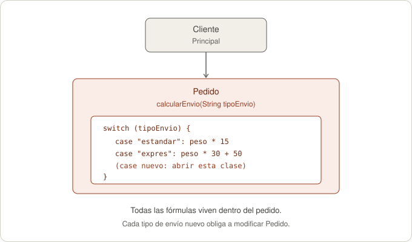
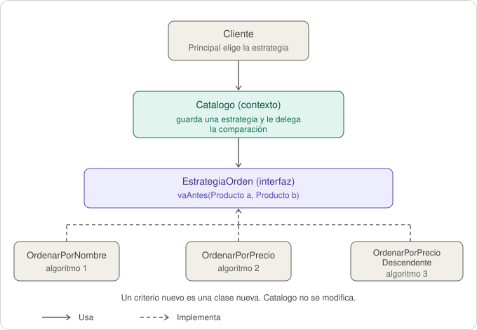
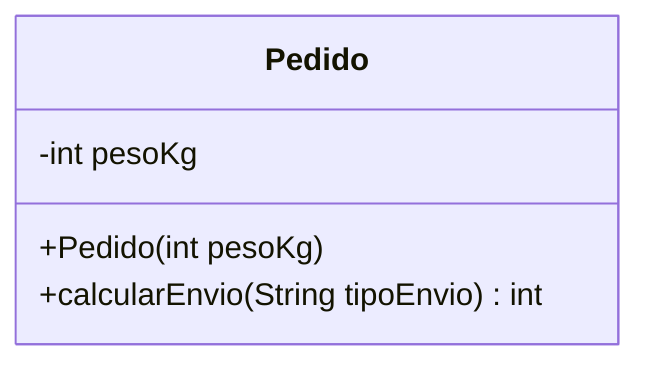
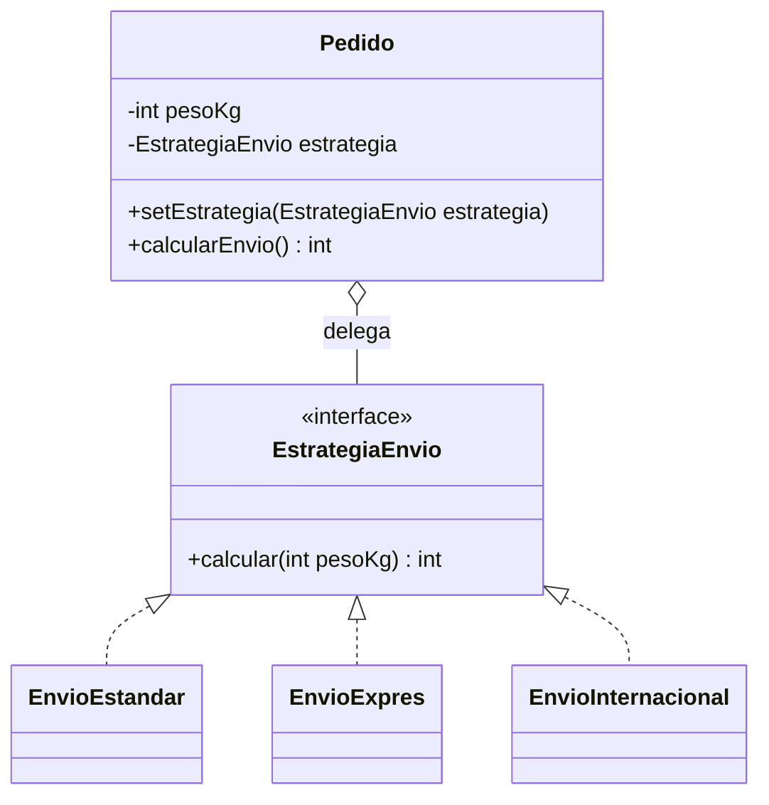

# Patrón 6. Strategy

## Objetivo

Reconocer el patrón Strategy, ver qué problema resuelve cuando un mismo
trabajo se puede hacer de varias formas, y decidir cuándo conviene usarlo y
cuándo basta algo más simple.

El problema aparece cuando una clase decide con un `switch` o una cadena de
`if` cuál de varios algoritmos ejecutar. Cada variante nueva obliga a abrir
esa clase, y todos los algoritmos quedan mezclados con el resto de su código.
Strategy saca cada algoritmo a su propia clase, todas con la misma interfaz, y
la clase que los usa recibe el que le toca. Cambiar de algoritmo es cambiar el
objeto que se le entrega.

## Conocimientos de POO necesarios para la implementación del patrón

Strategy se apoya en varias ideas de programación orientada a objetos. Si
alguna no está clara, conviene repasarla antes de seguir, porque los
diagramas y el código que siguen las dan por sabidas. La columna "Dónde se ve
en los diagramas de clases" remite a la sección Diagramas de clases, más
abajo.

| Concepto | Dónde se ve en los diagramas de clases | En una frase |
|---|---|---|
| Interfaz | `EstrategiaEnvio` | Es un contrato. Dice qué pregunta debe saber responder cualquier tipo de envío (`calcular`), sin escribir cómo. Quien la usa no necesita saber cuál tipo recibió |
| Implementación | Flechas punteadas de `EnvioEstandar`, `EnvioExpres` y `EnvioInternacional` hacia `EstrategiaEnvio` (`implements`) | Cada clase se compromete a cumplir el contrato y decide cómo. Si le falta el método, no compila |
| Composición (en sentido general) | `-EstrategiaEnvio estrategia` dentro de `Pedido`, y la línea con rombo hueco llamada `delega` | El pedido guarda una referencia a una estrategia en un atributo. En UML estricto este caso se dibuja como agregación, y la razón se explica debajo de la tabla |
| Delegación | `estrategia.calcular(pesoKg)` dentro de `Pedido.calcularEnvio()` | El pedido no calcula el envío. Le pregunta a la estrategia y devuelve su respuesta |
| Constructor que recibe una dependencia, y método `set` | `Pedido(int, EstrategiaEnvio)` y `setEstrategia(...)` | El pedido recibe la estrategia ya creada y no la crea él. Con el método `set` se puede cambiar por otra mientras el programa corre |
| Polimorfismo | No se dibuja | `calcularEnvio()` llama a `estrategia.calcular(...)`. Al ejecutarse, Java usa el objeto real que está guardado, que puede ser cualquiera de las tres clases, aunque el atributo esté declarado con el tipo de la interfaz |
| Interfaz funcional y lambda | No se dibuja. Solo aparece en `java/alternativa-funcional` | Una interfaz con un solo método abstracto se puede implementar escribiendo solo una función, `peso -> peso * 15`, sin escribir una clase (Oracle, s. f.) |

Sobre el término "composición". En este README se usa en el sentido general
de la programación orientada a objetos, que es guardar una referencia a otro
objeto en un atributo y delegarle trabajo (Gamma et al., 1994). UML es más
estricto. La composición, que se dibuja con rombo relleno, significa que el
todo es dueño de la parte, y que si el todo se elimina sus partes también
(UML Diagrams, s. f.-a). Aquí no ocurre eso, porque `Principal` crea la
estrategia y se la entrega al pedido, así que la estrategia existe aunque el
pedido no. Ese caso es una agregación, que se dibuja con rombo hueco (UML
Diagrams, s. f.-b). El rombo va del lado del todo, es decir, del pedido.

Si estos conceptos todavía te cuestan, es normal. Una buena forma de
revisarlos es leer `java/sin-patron`, donde el `switch` está dentro de
`Pedido`, y compararlo con `java/con-patron`, donde aparece la interfaz y una
clase por tipo de envío.

## Sin el patrón

Esta es la idea en su forma más simple. Un pedido calcula su costo de envío, y
el tipo de envío llega como texto a un `switch` dentro de la propia clase
`Pedido`. Las fórmulas viven ahí, mezcladas con todo lo demás. Agregar un tipo
de envío obliga a abrir esa clase y modificarla.



## El patrón en breve

Strategy define una familia de algoritmos, encapsula cada uno y los hace
intercambiables, de modo que el algoritmo pueda variar sin que cambie quien lo
usa (Gamma et al., 1994). Es como una navaja suiza. El mango es siempre el
mismo, y las herramientas son intercambiables, como la cuchilla, el desarmador
y las tijeras. El mango no sabe cómo está hecha cada herramienta, solo la usa,
y cambiar de herramienta no cambia el mango.

En el ejemplo de la práctica, un pedido calcula su costo de envío. Las piezas
son tres.

- **Interfaz de la estrategia** (`EstrategiaEnvio`). El contrato que cumplen
  todos los tipos de envío.
- **Estrategias concretas** (`EnvioEstandar`, `EnvioExpres` y
  `EnvioInternacional`). Cada una es una fórmula distinta, y todas cumplen la
  misma interfaz.
- **Contexto** (`Pedido`). La clase que usa una estrategia. Es el mango de la
  navaja. Guarda una estrategia y le delega el cálculo.

Así se ve la idea. El contexto ya no contiene las fórmulas. Guarda una
estrategia y le pregunta lo que necesita saber. Quien arma el programa, que
aquí es `Principal`, decide cuál estrategia entregarle.



## Diagramas de clases

Las imágenes anteriores muestran la idea. Aquí están los mismos dos
escenarios como diagramas de clases, con la notación UML que se usa en la
documentación de software.

### Versión sin patrón

En `java/sin-patron` hay una sola clase que importa. `Pedido` recibe el tipo
de envío como texto en `calcularEnvio()` y lo resuelve con un `switch`.



Las dos fórmulas están dentro de `calcularEnvio()`. Para agregar el envío
internacional hay que abrir `Pedido` y agregar otro `case`.

### Versión con patrón

Con Strategy, `Pedido` ya no conoce las fórmulas. Guarda una
`EstrategiaEnvio` y la usa. Cada tipo de envío es una clase que implementa la
interfaz.



Compara con la versión sin patrón. `Pedido` no tiene ninguna flecha hacia las
tres clases de envío, solo hacia la interfaz. El único lugar que las crea y
las entrega es `Principal`, que no se dibuja para que el diagrama se lea.

## Cuándo sí y cuándo no

Si hay dos o tres variantes y cada una es una fórmula corta, un `switch` o un
`if` limpio es más simple y más fácil de leer. Una familia de clases ahí es la
sobreingeniería de la que habla el README general, y conviene empezar por lo
sencillo y abstraer cuando el cambio ya duele, no antes (Beck y Andres, 2004).
La sección siguiente ordena los pasos intermedios. Strategy con clases empieza a valer la pena cuando se cumple alguna de estas
situaciones.

- Cada algoritmo es largo o complejo, por ejemplo con validaciones, consultas
  a una base de datos o llamadas a un servicio, y merece su propia clase, que
  se pueda probar por separado.
- El mismo `switch` se repite en varias clases, y cada regla nueva obliga a
  corregirlas todas.
- El algoritmo se elige o se cambia mientras el programa corre, por ejemplo
  porque el usuario lo escoge.
- El algoritmo necesita guardar estado propio o tener varios métodos.

También tiene costos. Quien arma el programa debe conocer las estrategias para
poder elegir una (Gamma et al., 1994), y a cambio de poder agregar algoritmos
sin tocar el contexto, hay más clases que leer.

Strategy y Decorator se parecen en que los dos reciben otro objeto por
composición. Se distinguen por lo que hacen con él. Un decorador envuelve a un
objeto de su mismo tipo y le suma comportamiento. Una estrategia reemplaza el
algoritmo con el que el contexto hace su trabajo.

## De lo simple a lo flexible

Entre un `switch` con el código adentro y una familia de clases hay peldaños
intermedios. Conviene subir solo hasta donde el problema lo pida, y subir un
peldaño cuando el anterior empieza a doler, no antes (Beck y Andres, 2004;
Kerievsky, 2004). La escalera es esta.

1. **Un `switch` con el código dentro de cada `case`.** Sirve mientras cada
   fórmula sea corta. Es la versión de `java/sin-patron`.
2. **Un `switch` que llama a una función por cada `case`.** Cuando los cálculos
   se alargan, se extrae cada uno a su propio método y el `case` solo lo llama.
   Esto resuelve los cuerpos largos sin ningún patrón, y es la primera
   respuesta razonable. Aquí hay un fragmento ilustrativo, que no forma parte
   de los archivos de la práctica, para el mismo `Pedido`.

   ```java
   public int calcularEnvio(String tipoEnvio) {
       switch (tipoEnvio) {
           case "estandar": return calcularEstandar();
           case "expres":   return calcularExpres();
           default:
               throw new IllegalArgumentException("Tipo de envio desconocido: " + tipoEnvio);
       }
   }

   private int calcularEstandar() { return pesoKg * 15; }
   private int calcularExpres()   { return pesoKg * 30 + 50; }
   ```

3. **Pasar la función por parámetro.** Quien usa la clase entrega la función
   que quiere, y la clase solo la ejecuta. En C es un apuntador a función, como
   la función de comparación que recibe `qsort`. En Java es una lambda, como en
   `java/alternativa-funcional`.
4. **Una clase por variante.** Es el patrón Strategy completo, como en
   `java/con-patron`. Se justifica cuando cada variante necesita estado propio,
   varios métodos o pruebas por separado.

La diferencia entre el segundo y el tercer peldaño es quién conoce la lista de
variantes. En el segundo, `Pedido` sigue conociéndola. Los cuerpos ya son
cortos, pero agregar el envío internacional obliga a abrir `Pedido` y agregar
otro `case`, y si el mismo `switch` se repite en otras clases, hay que
corregirlas todas. Del tercer peldaño en adelante, la decisión pasa a quien usa
la clase, y `Pedido` ya no necesita cambiar. Por eso Strategy no es una
respuesta a las fórmulas largas, que ya resuelve el segundo peldaño. Es una
respuesta a quién decide, y a cuántos lugares hay que tocar cuando las
variantes cambian.

## La alternativa sin clases

Antes de escribir una familia de clases, vale la pena preguntarse si basta con
pasar funciones. Norvig (1996) sostuvo que 16 de los 23 patrones del libro de
Gamma et al. tienen una implementación cualitativamente más simple en lenguajes
dinámicos como Lisp o Dylan que en C++. Strategy es uno de ellos, junto con
Command, Template Method y Visitor, porque en esos lenguajes las funciones son
valores de primera clase. Su resumen es que la estrategia es una variable cuyo
valor es una función y que, con funciones de primera clase, el patrón "es
invisible" (Norvig, 1996, traducción propia).

Hay dos advertencias para leer esa afirmación con cuidado.

- **No habla de Java.** Norvig compara Lisp y Dylan contra C++. Java es de tipos
  estáticos, y una función necesita un tipo. Lo que ofrece es la interfaz
  funcional, que es una interfaz con un solo método abstracto y cuyas
  instancias se pueden crear con expresiones lambda (Oracle, s. f.). Así, el
  patrón no desaparece, pero se aligera, porque la interfaz sigue, y las clases
  de cada estrategia se vuelven una línea.
- **El estado complica la alternativa.** Norvig anota que las funciones
  capturan las variables locales de donde se crean. En Java, una lambda solo
  puede usar las variables locales que no cambian después de asignarse. Si
  intenta modificar una, el compilador marca `local variables referenced from a
  lambda expression must be final or effectively final`. Cuando la estrategia
  necesita llevar estado que cambia, una clase es más natural.

La carpeta `java/alternativa-funcional` tiene el mismo ejemplo resuelto sin una
clase por tipo de envío. Usa la misma interfaz y el mismo `Pedido`, y cada
estrategia es una lambda. También muestra un mapa de nombre a función, que se
parece a un arreglo de apuntadores a función en C. Es una práctica opcional,
para comparar tres formas de resolver lo mismo: un `switch`, una clase por
estrategia y una función por estrategia. Una regla razonable es empezar por el
`switch` o por funciones, y pasar a clases cuando los algoritmos crezcan, se
repitan o necesiten estado.

## Práctica en Java (20 min)

Antes de ejecutar cada programa, anota qué crees que va a imprimir.
Comparar tu predicción con el resultado es lo más valioso de la práctica.

1. **Sin patrón.** Lee `java/sin-patron/Pedido.java`. Ubica el `switch` y
   fíjate cuántas fórmulas hay dentro de esa clase. Predice la salida para un
   pedido de 4 kg y ejecútalo.
2. **Con patrón.** Lee `java/con-patron/EstrategiaEnvio.java`,
   `EnvioExpres.java` y `Principal.java`. Fíjate que `Pedido` ya no menciona
   ninguna fórmula. Predice cuánto costará el envío internacional de 4 kg y
   ejecútalo.
3. **Comparar.** Para agregar el envío por dron, ¿qué archivos habría que
   modificar o escribir en cada versión? Y si en `Principal` escribieras
   `"express"` en lugar de `"expres"`, o `EnvioExpress` en lugar de
   `EnvioExpres`, ¿cuándo te enterarías del error en cada versión?
4. **Opcional.** Abre `java/alternativa-funcional/Principal.java` y compáralo
   con el de `con-patron`. ¿Qué desapareció? ¿Qué se conserva?

### Cómo ejecutar

Desde la terminal, entra a la carpeta de cada versión y compila todo junto.

```
cd java/sin-patron
javac *.java
java Principal
```

Repite con `java/con-patron` y, si quieres, con `java/alternativa-funcional`.
En VS Code, abre una versión a la vez (menú *File > Open Folder*), porque las
carpetas tienen clases con el mismo nombre.

## Qué gana y qué cuesta usar Strategy

| Aspecto | Sin patrón | Con patrón | Alternativa funcional |
|---|---|---|---|
| Dónde viven las fórmulas | Dentro de `Pedido.calcularEnvio()`, en un `switch` | Una por clase, fuera de `Pedido` | Una lambda por tipo de envío, fuera de `Pedido` |
| Agregar el envío internacional | Abrir `Pedido` y agregar un `case` | Escribir una clase nueva y usarla en `Principal` | Escribir una lambda nueva y usarla en `Principal` |
| Cómo se elige el tipo de envío | Con un texto, como `"expres"` | Con un objeto, como `new EnvioExpres()` | Con una lambda, o con un texto si se usa el mapa |
| Error de dedo al elegir | Compila y falla al ejecutar con `IllegalArgumentException` | No compila | Con lambdas no compila. Con el mapa y un texto mal escrito, `get` devuelve `null` y falla al ejecutar |
| Cambiar de tipo de envío mientras corre | Mandar otro texto a `calcularEnvio()` | Llamar a `setEstrategia()` | Llamar a `setEstrategia()` |
| Clases con dos tipos de envío | 2 (`Pedido` y `Principal`) | 5 (las anteriores, la interfaz y dos estrategias) | 3 (las dos primeras y la interfaz) |
| Clases con tres tipos de envío | 2, y `Pedido` crece | 6, y `Pedido` no cambia | 3, y `Pedido` no cambia |
| Costo | Pocas piezas al inicio, pero la clase crece con cada fórmula | Más piezas desde el principio, y quien arma el programa debe conocer las estrategias | Pocas piezas, pero una lambda no se prueba ni se reutiliza tan fácil como una clase con nombre, y el estado que cambia complica |

Con dos tipos de envío y fórmulas de una línea, la versión sin patrón es la más
corta y la más clara. El patrón gana cuando las fórmulas crecen o se repiten, y
la alternativa funcional gana cuando son cortas pero se quiere cambiarlas o
agregarlas sin tocar `Pedido`.

## Árbol de archivos

```
06 - Strategy/
├── README.md
├── img/                      diagramas de este README en formato SVG
├── java/
│   ├── sin-patron/           Pedido.java y Principal.java
│   ├── con-patron/           EstrategiaEnvio.java, EnvioEstandar.java,
│   │                         EnvioExpres.java, EnvioInternacional.java,
│   │                         Pedido.java y Principal.java
│   └── alternativa-funcional/ EstrategiaEnvio.java, Pedido.java y Principal.java
└── referencia-csharp/        versión original en C#, con ordenamiento de
                              productos, solo de consulta
```

Los programas no llevan acentos a propósito, para evitar problemas de
codificación en la consola de Windows. Los costos son pesos enteros (`int`)
para no mezclar esta práctica con el tema de precisión decimal que se vio en
Adapter. La versión en C# de la carpeta `referencia-csharp` usa otro ejemplo,
el de ordenar productos por nombre o por precio, pero la estructura del patrón
es la misma.

## Anexos

### Referencia a patrones arquitectónicos

En el Taller de Arquitecturas de Software no hay un Strategy literal, es
decir, no hay una familia de algoritmos intercambiables que un contexto elija
para hacer un mismo cálculo. Lo más cercano en la estructura es cómo el
dominio recibe su repositorio desde afuera, en el
[Taller de Arquitecturas de Software](https://github.com/carevalomx69/Taller-de-Arquitecturas-de-Software).

| Práctica | Archivo | Qué hace |
|---|---|---|
| 4. Hexagonal | `04-hexagonal/backend/domain/taskDomain.js` | Las funciones del dominio reciben `repo` como primer parámetro, por ejemplo `list(repo, userId)`. No saben si es el de MySQL o el de Postgres, solo que cumple el contrato de las tres operaciones de tareas |
| 4. Hexagonal | `04-hexagonal/backend/test_domain.js` | `createFakeRepo()` entrega un repositorio falso, en memoria, que cumple el mismo contrato. El dominio funciona igual con él |

El parecido es el mecanismo. A quien hace el trabajo se le entrega un objeto
que cumple un contrato, y quien lo entrega puede cambiarlo sin tocar el
código que lo usa. Pero el propósito no es el mismo. Strategy intercambia
algoritmos que hacen el mismo trabajo de distinta forma. Aquí el repositorio
es la frontera hacia la infraestructura, que es la función de los puertos y
adaptadores que viste en el patrón Adapter. Ábrelos y compara qué se
intercambia en cada caso.

### Errores comunes

| Problema | Causa probable | Solución |
|---|---|---|
| `cannot find symbol` al compilar | Se compiló solo un archivo y faltan los demás | Usa `javac *.java` dentro de la carpeta |
| `class X is public, should be declared in a file named X.java` | El nombre del archivo no coincide con el de la clase pública | Cada clase pública va en un archivo con su mismo nombre |
| `javac` no se reconoce como comando | El JDK no está instalado o no está en el PATH | Usa el IDE de tu curso de Java |
| `NullPointerException` en `calcularEnvio()` | El contexto se creó con una estrategia `null`, o el mapa no tenía el nombre que se buscó | Entrega una estrategia válida en el constructor o con `setEstrategia()`, y revisa el texto con que se busca en el mapa |

## Entregable

Evidencia de que ejecutaste las dos versiones, sin patrón y con patrón.
Puede ser una captura de la salida de cada una o el texto copiado de la
consola, y una línea que diga qué diferencia notaste entre ambas.

Tu predicción no tiene que acertar. Lo que se revisa es que lo ejecutaste y
que observaste la diferencia.

## Referencias

Beck, K. y Andres, C. (2004). *Extreme Programming Explained: Embrace Change*
(2.ª ed.). Addison-Wesley.

Gamma, E., Helm, R., Johnson, R. y Vlissides, J. (1994). *Design Patterns:
Elements of Reusable Object-Oriented Software*. Addison-Wesley.

Kerievsky, J. (2004). *Refactoring to Patterns*. Addison-Wesley.

Norvig, P. (1996). *Design Patterns in Dynamic Languages* [Presentación].
https://norvig.com/design-patterns/

Oracle. (s. f.). *FunctionalInterface* (Java SE 21 y JDK 21). Documentación
de la API.
https://docs.oracle.com/en/java/javase/21/docs/api/java.base/java/lang/FunctionalInterface.html

UML Diagrams. (s. f.-a). *UML composition*.
https://www.uml-diagrams.org/composition.html

UML Diagrams. (s. f.-b). *UML aggregation*.
https://www.uml-diagrams.org/aggregation.html
