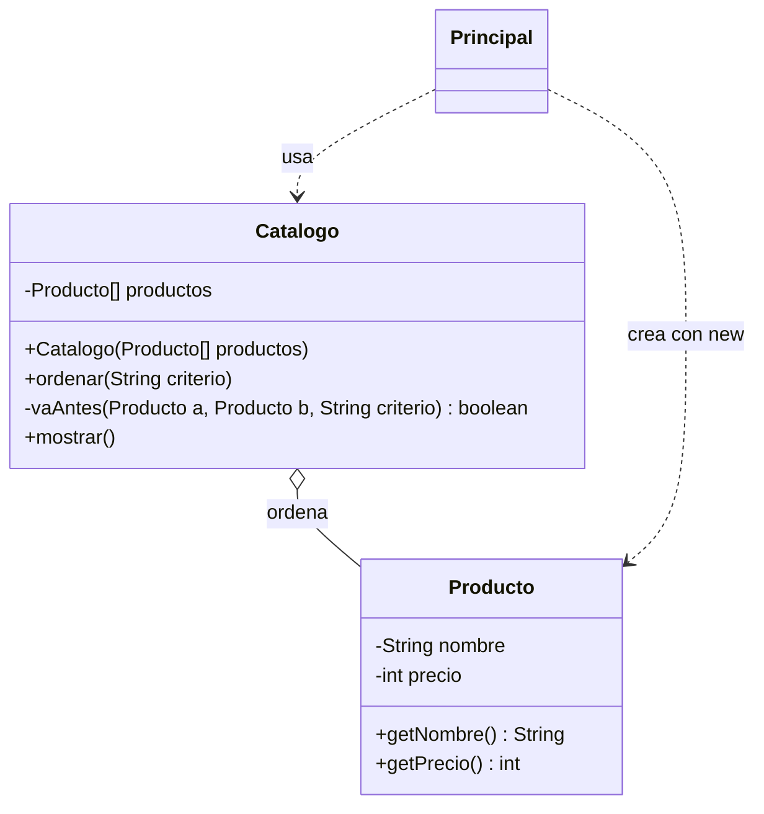
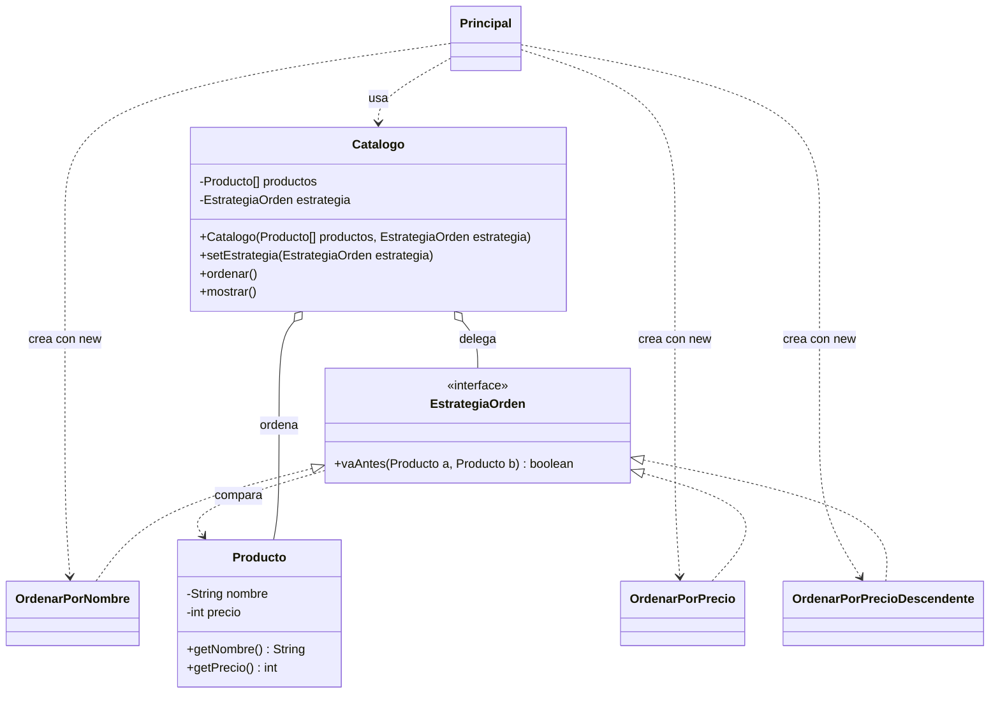

# Patrón 6. Strategy

## Objetivo

Reconocer el patrón Strategy, ver qué problema resuelve cuando un mismo
trabajo se puede hacer de varias formas, y decidir cuándo conviene usarlo.

El problema aparece cuando una clase decide con un `switch` o una cadena de
`if` cuál de varios algoritmos ejecutar. Cada variante nueva obliga a abrir
esa clase, y todos los algoritmos quedan mezclados con el resto de su código.
Strategy saca cada algoritmo a su propia clase, todas con la misma interfaz, y
la clase que los usa recibe el que le toca. Cambiar de algoritmo es cambiar el
objeto que se le entrega.

## Conocimientos de POO necesarios para la implementación del patrón

Strategy se apoya en varias ideas de programación orientada a objetos. Si
alguna no está clara, conviene repasarla antes de seguir, porque los
diagramas y el código que siguen las dan por sabidas. La columna "Dónde se ve
en los diagramas de clases" remite a la sección Diagramas de clases, más
abajo.

| Concepto | Dónde se ve en los diagramas de clases | En una frase |
|---|---|---|
| Interfaz | `EstrategiaOrden` | Es un contrato. Dice qué pregunta debe saber responder cualquier criterio de orden (`vaAntes`), sin escribir cómo. Quien la usa no necesita saber cuál criterio recibió |
| Implementación | Flechas punteadas de `OrdenarPorNombre`, `OrdenarPorPrecio` y `OrdenarPorPrecioDescendente` hacia `EstrategiaOrden` (`implements`) | Cada clase se compromete a cumplir el contrato y decide cómo. Si le falta el método, no compila |
| Composición (en sentido general) | `-EstrategiaOrden estrategia` dentro de `Catalogo`, y la línea con rombo hueco llamada `delega` | El catálogo guarda una referencia a una estrategia en un atributo. En UML estricto este caso se dibuja como agregación, y la razón se explica debajo de la tabla |
| Delegación | `estrategia.vaAntes(...)` dentro de `Catalogo.ordenar()` | El catálogo no compara los productos. Le pregunta a la estrategia y usa su respuesta |
| Constructor que recibe una dependencia, y método `set` | `Catalogo(Producto[], EstrategiaOrden)` y `setEstrategia(...)` | El catálogo recibe la estrategia ya creada y no la crea él. Con el método `set` se puede cambiar por otra mientras el programa corre |
| Polimorfismo | No se dibuja | `ordenar()` llama a `estrategia.vaAntes(...)`. Al ejecutarse, Java usa el objeto real que está guardado, que puede ser cualquiera de las tres clases, aunque el atributo esté declarado con el tipo de la interfaz |

Sobre el término "composición". En este README se usa en el sentido general
de la programación orientada a objetos, que es guardar una referencia a otro
objeto en un atributo y delegarle trabajo (Gamma et al., 1994). UML es más
estricto. La composición, que se dibuja con rombo relleno, significa que el
todo es dueño de la parte, y que si el todo se elimina sus partes también
(UML Diagrams, s. f.-a). Aquí no ocurre eso, porque `Principal` crea la
estrategia y se la entrega al catálogo, así que la estrategia existe aunque
el catálogo no. Ese caso es una agregación, que se dibuja con rombo hueco (UML
Diagrams, s. f.-b). El rombo va del lado del todo, es decir, del catálogo.

El ordenamiento que hace `Catalogo.ordenar()` es una versión sencilla del
ordenamiento por selección, escrita a mano para que el ejemplo no dependa de
nada más. No es lo que se estudia en la práctica. Lo importante es que ese
ciclo es igual en las dos versiones, y que lo único que cambia es quién
responde la pregunta "este producto, va antes que este otro?".

Si estos conceptos todavía te cuestan, es normal. Una buena forma de
revisarlos es leer `java/sin-patron`, donde el `switch` está dentro de
`Catalogo`, y compararlo con `java/con-patron`, donde aparece la interfaz y
una clase por criterio.

## Sin el patrón

Esta es la idea en su forma más simple. La clase `Catalogo` ordena los
productos y decide el criterio con un `switch` interno, que recibe el nombre
del criterio como texto. Los dos algoritmos viven dentro de esa clase,
mezclados con el ciclo de ordenamiento, y agregar un criterio obliga a abrirla
y modificarla.


## El patrón en breve

Strategy define una familia de algoritmos, encapsula cada uno y los hace
intercambiables, de modo que el algoritmo pueda variar sin que cambie quien lo
usa (Gamma et al., 1994). Es como elegir la ruta en una aplicación de mapas.
El origen y el destino son los mismos, y puedes escoger la ruta más rápida, la
más corta o la que evita casetas. La aplicación cambia de ruta sin cambiar de
viaje.

En el ejemplo de la práctica, un catálogo ordena productos. Las piezas son
tres.

- **Interfaz de la estrategia** (`EstrategiaOrden`). El contrato que cumplen
  todos los criterios de orden.
- **Estrategias concretas** (`OrdenarPorNombre`, `OrdenarPorPrecio` y
  `OrdenarPorPrecioDescendente`). Cada una es un algoritmo, y todas cumplen la
  misma interfaz.
- **Contexto** (`Catalogo`). La clase que usa una estrategia. Guarda una y le
  delega la parte que cambia.

Así se ve la idea. El contexto ya no contiene los algoritmos. Guarda una
estrategia y le pregunta lo que necesita saber. Quien arma el programa, que
aquí es `Principal`, decide cuál estrategia entregarle.


## Diagramas de clases

Las imágenes anteriores muestran la idea. Aquí están los mismos dos
escenarios como diagramas de clases, con la notación UML que se usa en la
documentación de software.

### Versión sin patrón

En `java/sin-patron` no hay interfaz ni estrategias. `Catalogo` recibe el
criterio como texto en `ordenar()` y lo resuelve con un `switch` en un método
privado.



Los dos algoritmos están dentro de `vaAntes()`. Para ordenar por precio de
mayor a menor hay que abrir `Catalogo` y agregar otro `case`.

### Versión con patrón

Con Strategy, `Catalogo` ya no conoce los criterios. Guarda una
`EstrategiaOrden` y la usa. Cada criterio es una clase que implementa la
interfaz.



Compara con la versión sin patrón. `Catalogo` no tiene ninguna flecha hacia
las tres clases de criterio, solo hacia la interfaz. El único lugar que las
conoce es `Principal`, que es donde se arma todo.

## Cuándo sí y cuándo no

Si hay dos variantes y no se espera que aparezcan más, un `if` es más simple
y más fácil de leer. Una familia de clases ahí es la sobreingeniería de la
que habla el README general. Strategy empieza a valer la pena cuando se
cumple alguna de estas situaciones.

- Hay varias formas de hacer lo mismo, y se espera que aparezcan más.
- El algoritmo se elige o se cambia mientras el programa corre, por ejemplo
  porque el usuario lo escoge.
- Cada algoritmo es lo bastante largo o complejo como para merecer su propia
  clase, que se pueda probar por separado.

También tiene costos. Quien arma el programa debe conocer las estrategias
para poder elegir una (Gamma et al., 1994), y a cambio de poder agregar
algoritmos sin tocar el contexto, hay más clases que leer.

Un ejemplo real en la propia biblioteca de Java es `Comparator`. Es una
interfaz con un método `compare`, y se le pasa a métodos de ordenamiento como
`Arrays.sort` para controlar el criterio de orden (Oracle, s. f.). Es la misma
idea que `EstrategiaOrden`. La diferencia es que `compare` devuelve un entero
(negativo, cero o positivo) en lugar de `true` o `false`, porque así también
distingue el empate. Aquí se usó una pregunta de sí o no para que el ejemplo
fuera más corto.

Strategy y Decorator se parecen en que los dos reciben otro objeto por
composición. Se distinguen por lo que hacen con él. Un decorador envuelve a un
objeto de su mismo tipo y le suma comportamiento. Una estrategia reemplaza el
algoritmo con el que el contexto hace su trabajo.

## Práctica en Java (20 min)

Antes de ejecutar cada programa, anota qué crees que va a imprimir.
Comparar tu predicción con el resultado es lo más valioso de la práctica.

1. **Sin patrón.** Lee `java/sin-patron/Catalogo.java`. Ubica el `switch` y
   fíjate cuántos algoritmos hay dentro de esa clase. Predice la salida y
   ejecútalo.
2. **Con patrón.** Lee `java/con-patron/EstrategiaOrden.java`,
   `OrdenarPorPrecio.java` y `Principal.java`. Fíjate que el ciclo de
   `Catalogo.ordenar()` ya no menciona ningún criterio. Predice en qué orden
   quedarán los productos con `OrdenarPorPrecioDescendente` y ejecútalo.
3. **Comparar.** Para ordenar por nombre de la Z a la A, ¿qué archivos habría
   que modificar o escribir en cada versión? Y si en `Principal` escribieras
   `"presio"` en lugar de `"precio"`, o `OrdenarPorPresio` en lugar de
   `OrdenarPorPrecio`, ¿cuándo te enterarías del error en cada versión?

### Cómo ejecutar

Desde la terminal, entra a la carpeta de cada versión y compila todo junto.

```
cd java/sin-patron
javac *.java
java Principal
```

Repite con `java/con-patron`. En VS Code, abre una versión a la vez (menú
*File > Open Folder*), porque las dos carpetas tienen clases con el mismo
nombre.

## Qué gana y qué cuesta usar Strategy

| Aspecto | Sin patrón | Con patrón |
|---|---|---|
| Dónde viven los algoritmos | Dentro de `Catalogo.vaAntes()`, en un `switch` | Uno por clase, fuera de `Catalogo` |
| Agregar el criterio de precio descendente | Abrir `Catalogo` y agregar un `case` | Escribir una clase nueva y usarla en `Principal` |
| Cómo se elige el criterio | Con un texto, como `"nombre"` | Con un objeto, como `new OrdenarPorNombre()` |
| Error de dedo al elegir el criterio | Compila y falla al ejecutar con `IllegalArgumentException` | No compila |
| Cambiar de criterio mientras corre | Mandar otro texto a `ordenar()` | Llamar a `setEstrategia()` |
| Clases con dos criterios | 3 (`Producto`, `Catalogo` y `Principal`) | 6 (las anteriores, la interfaz y dos estrategias) |
| Clases con tres criterios | 3, y `Catalogo` crece | 7, y `Catalogo` no cambia |
| Costo | Pocas piezas al inicio, pero la clase crece con cada algoritmo | Más piezas desde el principio, y quien arma el programa debe conocer las estrategias |

Con dos criterios la versión sin patrón es más corta y igual de clara. El
patrón gana cuando los criterios se acumulan, o cuando hay que elegirlos o
cambiarlos mientras el programa corre.

## Árbol de archivos

```
06 - Strategy/
├── README.md
├── img/                   diagramas de este README en formato SVG
├── java/
│   ├── sin-patron/        Producto.java, Catalogo.java y Principal.java
│   └── con-patron/        Producto.java, EstrategiaOrden.java,
│                          OrdenarPorNombre.java, OrdenarPorPrecio.java,
│                          OrdenarPorPrecioDescendente.java, Catalogo.java
│                          y Principal.java
└── referencia-csharp/     versión original en C#, solo de consulta
```

Los programas no llevan acentos a propósito, para evitar problemas de
codificación en la consola de Windows. Los precios son pesos enteros (`int`)
para no mezclar esta práctica con el tema de precisión decimal que se vio en
Adapter.

## Anexos

### Referencia a patrones arquitectónicos

En el Taller de Arquitecturas de Software no hay un Strategy literal, es
decir, no hay una familia de algoritmos intercambiables que un contexto elija
para hacer un mismo cálculo. Lo más cercano en la estructura es cómo el
dominio recibe su repositorio desde afuera, en el
[Taller de Arquitecturas de Software](https://github.com/carevalomx69/Taller-de-Arquitecturas-de-Software).

| Práctica | Archivo | Qué hace |
|---|---|---|
| 4. Hexagonal | `04-hexagonal/backend/domain/taskDomain.js` | Las funciones del dominio reciben `repo` como primer parámetro, por ejemplo `list(repo, userId)`. No saben si es el de MySQL o el de Postgres, solo que cumple el contrato de las tres operaciones de tareas |
| 4. Hexagonal | `04-hexagonal/backend/test_domain.js` | `createFakeRepo()` entrega un repositorio falso, en memoria, que cumple el mismo contrato. El dominio funciona igual con él |

El parecido es el mecanismo. A quien hace el trabajo se le entrega un objeto
que cumple un contrato, y quien lo entrega puede cambiarlo sin tocar el
código que lo usa. Pero el propósito no es el mismo. Strategy intercambia
algoritmos que hacen el mismo trabajo de distinta forma. Aquí el repositorio
es la frontera hacia la infraestructura, que es la función de los puertos y
adaptadores que viste en el patrón Adapter. Ábrelos y compara qué se
intercambia en cada caso.

### Errores comunes

| Problema | Causa probable | Solución |
|---|---|---|
| `cannot find symbol` al compilar | Se compiló solo un archivo y faltan los demás | Usa `javac *.java` dentro de la carpeta |
| `class X is public, should be declared in a file named X.java` | El nombre del archivo no coincide con el de la clase pública | Cada clase pública va en un archivo con su mismo nombre |
| `javac` no se reconoce como comando | El JDK no está instalado o no está en el PATH | Usa el IDE de tu curso de Java |
| `NullPointerException` en `ordenar()` | El contexto se creó sin estrategia, o se le pasó `null` | Entrega una estrategia en el constructor, o llama a `setEstrategia()` antes de ordenar |

## Entregable

Evidencia de que ejecutaste las dos versiones, sin patrón y con patrón.
Puede ser una captura de la salida de cada una o el texto copiado de la
consola, y una línea que diga qué diferencia notaste entre ambas.

Tu predicción no tiene que acertar. Lo que se revisa es que lo ejecutaste y
que observaste la diferencia.

## Referencias

Gamma, E., Helm, R., Johnson, R. y Vlissides, J. (1994). *Design Patterns:
Elements of Reusable Object-Oriented Software*. Addison-Wesley.

Oracle. (s. f.). *Comparator* (Java SE 21 y JDK 21). Documentación de la API.
https://docs.oracle.com/en/java/javase/21/docs/api/java.base/java/util/Comparator.html

UML Diagrams. (s. f.-a). *UML composition*.
https://www.uml-diagrams.org/composition.html

UML Diagrams. (s. f.-b). *UML aggregation*.
https://www.uml-diagrams.org/aggregation.html
