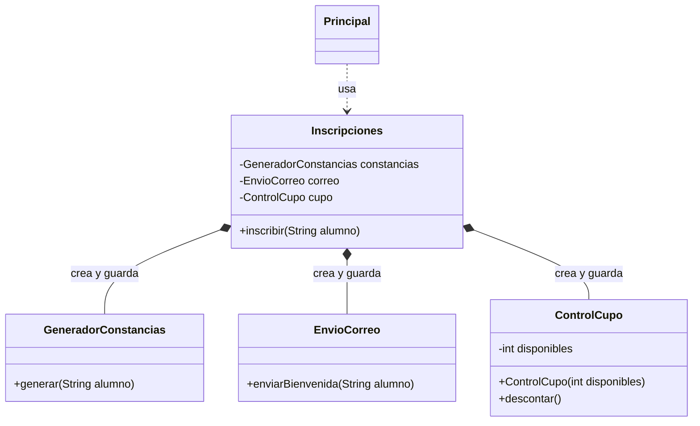
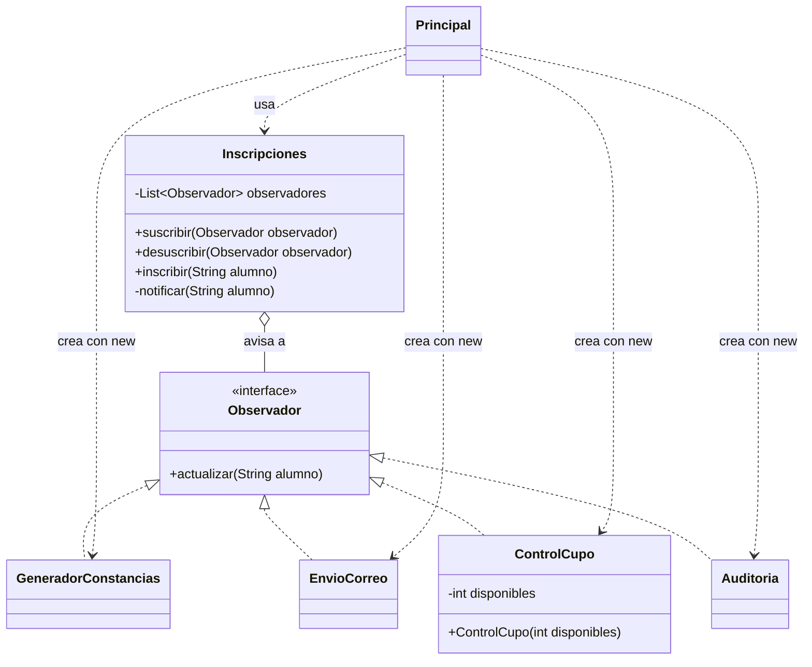

# Patrón 7. Observer

## Objetivo

Reconocer el patrón Observer, ver qué problema resuelve cuando varias partes
del sistema deben reaccionar a un mismo cambio, y decidir cuándo conviene
usarlo.

El problema aparece cuando un objeto cambia de estado y otros objetos
necesitan enterarse. Si el objeto que cambia llama directamente a cada
interesado, queda acoplado a todos ellos, y agregar o quitar uno obliga a
modificarlo. Observer invierte la relación. Los interesados se suscriben, y el
objeto que cambia solo conoce una interfaz común y avisa a todos los
suscritos.

## Conocimientos de POO necesarios para la implementación del patrón

Observer se apoya en varias ideas de programación orientada a objetos. Si
alguna no está clara, conviene repasarla antes de seguir, porque los
diagramas y el código que siguen las dan por sabidas. La columna "Dónde se ve
en los diagramas de clases" remite a la sección Diagramas de clases, más
abajo.

| Concepto | Dónde se ve en los diagramas de clases | En una frase |
|---|---|---|
| Interfaz | `Observador` | Es un contrato. Dice que cualquier observador tiene un método `actualizar`, sin escribir qué hace. Es lo único que el sujeto sabe de sus interesados |
| Implementación | Flechas punteadas de `GeneradorConstancias`, `EnvioCorreo`, `ControlCupo` y `Auditoria` hacia `Observador` (`implements`) | Cada clase se compromete a cumplir el contrato y decide qué hace al recibir el aviso. Si le falta el método, no compila |
| Colección de objetos | `List<Observador>` dentro de `Inscripciones` | Una lista que crece según se agregan elementos. El `<Observador>` indica que solo guarda objetos que cumplen esa interfaz. Se recorre con `for (Observador o : observadores)` |
| Composición y agregación | Rombo relleno en la versión sin patrón y rombo hueco en la versión con patrón | En los dos casos un objeto guarda a otros, pero cambia quién los crea. Se explica debajo de la tabla |
| Delegación | `observador.actualizar(alumno)` dentro de `notificar()` | `Inscripciones` no hace el trabajo de reaccionar. Avisa y cada observador hace lo suyo |
| Polimorfismo | No se dibuja | `notificar()` llama a `actualizar()` sobre cada elemento de la lista. Al ejecutarse, Java usa el objeto real de cada uno, que son clases distintas, aunque todos estén declarados con el tipo de la interfaz |

Sobre los rombos. En este README "composición" se usa en el sentido general de
la programación orientada a objetos, que es guardar una referencia a otro
objeto en un atributo (Gamma et al., 1994). UML distingue dos casos según
quién crea y es dueño de la parte. En la composición, que lleva rombo relleno,
el todo es dueño de la parte, y si el todo se elimina sus partes también (UML
Diagrams, s. f.-a). En la agregación, que lleva rombo hueco, la parte llega de
afuera y puede existir sin el todo (UML Diagrams, s. f.-b). Este patrón sirve
bien para ver la diferencia. En la versión sin patrón, `Inscripciones` crea con
`new` a los tres interesados y los guarda en atributos, así que es su dueña y
se dibuja composición. En la versión con patrón, los observadores se crean en
`Principal` y llegan por `suscribir()`, así que `Inscripciones` solo guarda
referencias y se dibuja agregación. El rombo va del lado del todo, que es
`Inscripciones` en los dos casos.

Si estos conceptos todavía te cuestan, es normal. Una buena forma de
revisarlos es leer `java/sin-patron`, donde `Inscripciones` crea y llama a
cada interesado, y compararlo con `java/con-patron`, donde aparecen la
interfaz, la lista y los observadores.

## Sin el patrón

Esta es la idea en su forma más simple. Cuando un alumno se inscribe a un
congreso, hay que generar su constancia, enviarle un correo de bienvenida y
descontar un lugar del cupo. La clase `Inscripciones` crea a esos tres
interesados y los llama uno por uno, cada uno con su propio nombre de método.
Agregar o quitar una reacción obliga a abrir y modificar `Inscripciones`.


## El patrón en breve

Observer define una dependencia de uno a muchos entre objetos, de modo que
cuando uno cambia de estado, todos sus dependientes son notificados
automáticamente (Gamma et al., 1994). También se le conoce como
publicación y suscripción (Gamma et al., 1994). Es como suscribirse a un canal
de noticias. El canal publica, no sabe quiénes lo siguen, y cada suscriptor
decide qué hacer con la noticia. Quien quiere dejar de recibirla se da de baja.

En el ejemplo de la práctica, las inscripciones a un congreso avisan a quien
le interese. Las piezas son tres.

- **Sujeto** (`Inscripciones`). El objeto que cambia. Guarda una lista de
  observadores y les avisa cuando ocurre una inscripción.
- **Interfaz del observador** (`Observador`). El contrato que cumplen todos
  los interesados, con el método `actualizar`.
- **Observadores concretos** (`GeneradorConstancias`, `EnvioCorreo`,
  `ControlCupo` y `Auditoria`). Cada uno hace algo distinto al recibir el aviso.

Así se ve la idea. El sujeto ya no conoce a nadie por su nombre. Recorre su
lista y llama a `actualizar()` en cada elemento. Quien arma el programa, que
aquí es `Principal`, decide quién se suscribe y quién se da de baja.


## Diagramas de clases

Las imágenes anteriores muestran la idea. Aquí están los mismos dos
escenarios como diagramas de clases, con la notación UML que se usa en la
documentación de software.

### Versión sin patrón

En `java/sin-patron` no hay interfaz ni lista. `Inscripciones` tiene tres
atributos, uno por cada interesado, los crea con `new` y los llama por el
nombre de su método.



Los rombos son rellenos porque `Inscripciones` crea a sus tres interesados y es
su dueña. Para agregar una bitácora hay que abrir la clase, agregar otro
atributo y otra llamada.

### Versión con patrón

Con Observer, `Inscripciones` ya no conoce a los interesados. Guarda una lista
de `Observador` y les avisa a todos con el mismo método. Cada interesado es una
clase que implementa la interfaz.



Compara con la versión sin patrón. `Inscripciones` no tiene ninguna flecha
hacia las cuatro clases de observadores, solo hacia la interfaz, y el rombo
pasó de relleno a hueco porque ya no las crea. El único lugar que las conoce
es `Principal`, que es donde se arma todo.

## Cuándo sí y cuándo no

Si solo hay un interesado y no se espera que haya más, llamarlo directamente
es más simple. Un observador ahí es la sobreingeniería de la que habla el
README general. Observer empieza a valer la pena cuando se cumple alguna de
estas situaciones.

- Varias partes del sistema deben reaccionar al mismo cambio, y se espera que
  aparezcan más.
- Quién se entera cambia mientras el programa corre, porque algunos se
  suscriben y otros se dan de baja.
- El objeto que cambia no debería conocer, ni depender de, quienes reaccionan.

También tiene costos. Como el sujeto no conoce a sus observadores, estos no
se conocen entre sí, y una acción pequeña puede desencadenar actualizaciones
en cadena que son difíciles de predecir (Gamma et al., 1994). Al leer
`inscribir()` ya no se ve quién reacciona, hay que mirar quién se suscribió.
Además, un observador que se suscribe y nunca se da de baja sigue en la lista
y no se libera de la memoria, un descuido frecuente con este tipo de
suscripciones (Bloch, 2018). En el código de esta práctica, los observadores se
avisan en el orden en que se suscribieron, y si uno lanzara una excepción,
interrumpiría el aviso a los que siguen.

## Práctica en Java (20 min)

Antes de ejecutar cada programa, anota qué crees que va a imprimir.
Comparar tu predicción con el resultado es lo más valioso de la práctica.

1. **Sin patrón.** Lee `java/sin-patron/Inscripciones.java`. Fíjate cuántas
   clases crea con `new` y con qué nombre llama a cada una. Predice la salida
   y ejecútalo.
2. **Con patrón.** Lee `java/con-patron/Observador.java`,
   `Inscripciones.java` y `Principal.java`. Predice qué líneas se imprimirán
   cuando se inscriba Beto, después de que el correo se dio de baja, y cuando
   se inscriba Carla, después de suscribir a `Auditoria`. Ejecútalo.
3. **Comparar.** Si se quisiera agregar un aviso por mensaje de texto, ¿qué
   archivos habría que modificar o escribir en cada versión? Y si se quisiera
   dejar de enviar el correo de bienvenida, ¿qué habría que hacer en cada una?

### Cómo ejecutar

Desde la terminal, entra a la carpeta de cada versión y compila todo junto.

```
cd java/sin-patron
javac *.java
java Principal
```

Repite con `java/con-patron`. En VS Code, abre una versión a la vez (menú
*File > Open Folder*), porque las dos carpetas tienen clases con el mismo
nombre.

## Qué gana y qué cuesta usar Observer

| Aspecto | Sin patrón | Con patrón |
|---|---|---|
| Quién conoce a los interesados | `Inscripciones`, que crea las tres clases concretas | Solo `Principal`, al suscribirlos. `Inscripciones` conoce la interfaz |
| Cómo se les avisa | Cada uno por su nombre (`generar`, `enviarBienvenida`, `descontar`) | Todos con `actualizar()` |
| Agregar la bitácora | Abrir `Inscripciones`, agregar un atributo y otra llamada | Escribir `Auditoria` y suscribirla en `Principal` |
| Dejar de avisar a alguien | Editar `Inscripciones` | Llamar a `desuscribir()` |
| Relación en UML | Composición, rombo relleno | Agregación, rombo hueco |
| Clases con tres reacciones | 5 (`Inscripciones`, las tres reacciones y `Principal`) | 6 (las anteriores y la interfaz) |
| Clases con cuatro reacciones | 6, y `Inscripciones` crece | 7, y `Inscripciones` no cambia |
| Costo | El orden y las llamadas se ven en un solo lugar | Más piezas, y al leer `inscribir()` no se ve quién reacciona |

Con una o dos reacciones fijas, la versión sin patrón es más corta y más fácil
de seguir. El patrón gana cuando los interesados aumentan o cambian mientras
el programa corre.

## Árbol de archivos

```
07 - Observer/
├── README.md
├── img/                   diagramas de este README en formato SVG
├── java/
│   ├── sin-patron/        GeneradorConstancias.java, EnvioCorreo.java,
│   │                      ControlCupo.java, Inscripciones.java y Principal.java
│   └── con-patron/        Observador.java, Inscripciones.java,
│                          GeneradorConstancias.java, EnvioCorreo.java,
│                          ControlCupo.java, Auditoria.java y Principal.java
└── referencia-csharp/     versión original en C#, con cotizaciones de acciones,
                           solo de consulta
```

Los programas no llevan acentos a propósito, para evitar problemas de
codificación en la consola de Windows. La versión en C# de la carpeta
`referencia-csharp` usa otro ejemplo, el de una acción de bolsa que avisa a
clientes móviles y de escritorio, pero la estructura del patrón es la misma.

## Anexos

### Referencia a patrones arquitectónicos

Aquí el patrón sí aparece, en su versión con intermediario. En el
[Taller de Arquitecturas de Software](https://github.com/carevalomx69/Taller-de-Arquitecturas-de-Software),
el servicio de tareas publica un evento cada vez que se crea o se completa una
tarea, y otros servicios se suscriben para reaccionar.

| Práctica | Archivo | Qué hace |
|---|---|---|
| 6. Orientada a eventos | `06-orientado-a-eventos/servicio-tareas/adapters/eventPublisher.js` | Es el sujeto. `publish()` envía el evento a RabbitMQ, por ejemplo `tarea.creada` y `tarea.completada`, sin saber quién lo recibirá |
| 6. Orientada a eventos | `06-orientado-a-eventos/servicio-auditoria/index.js` | Es un observador. `bindQueue(QUEUE, EXCHANGE, 'tarea.*')` es la suscripción, y `consume()` recibe cada evento y lo anota en la bitácora |
| 7. CQRS | `07-cqrs/servicio-consultas/index.js` | Es un segundo observador, con su propia cola (`cola_consultas`) y la misma suscripción `tarea.*`, de modo que recibe los mismos eventos que la auditoría |

La correspondencia es directa. Publicar es notificar, suscribir es
`bindQueue`, y cada servicio es un observador. Hay una diferencia que conviene
notar. En el patrón clásico, el sujeto guarda la lista de observadores y los
llama en el mismo programa. Aquí, la lista la guarda RabbitMQ, el sujeto ni
siquiera sabe cuántos hay, y el aviso viaja por la red y espera en una cola
hasta que el observador lo recoge. Es la misma idea con un intermediario en
medio, que se conoce como publicación y suscripción. Ábrelos y compara dónde
quedó cada pieza del diagrama: el sujeto, la lista y los observadores.

### Errores comunes

| Problema | Causa probable | Solución |
|---|---|---|
| `cannot find symbol` al compilar | Se compiló solo un archivo y faltan los demás | Usa `javac *.java` dentro de la carpeta |
| `class X is public, should be declared in a file named X.java` | El nombre del archivo no coincide con el de la clase pública | Cada clase pública va en un archivo con su mismo nombre |
| `javac` no se reconoce como comando | El JDK no está instalado o no está en el PATH | Usa el IDE de tu curso de Java |
| Un observador no recibe avisos | Se creó pero nunca se llamó a `suscribir()` con él | Suscríbelo en `Principal` antes de la inscripción que quieres observar |

## Entregable

Evidencia de que ejecutaste las dos versiones, sin patrón y con patrón.
Puede ser una captura de la salida de cada una o el texto copiado de la
consola, y una línea que diga qué diferencia notaste entre ambas.

Tu predicción no tiene que acertar. Lo que se revisa es que lo ejecutaste y
que observaste la diferencia.

## Referencias

Bloch, J. (2018). *Effective Java* (3.ª ed.). Addison-Wesley.

Gamma, E., Helm, R., Johnson, R. y Vlissides, J. (1994). *Design Patterns:
Elements of Reusable Object-Oriented Software*. Addison-Wesley.

UML Diagrams. (s. f.-a). *UML composition*.
https://www.uml-diagrams.org/composition.html

UML Diagrams. (s. f.-b). *UML aggregation*.
https://www.uml-diagrams.org/aggregation.html
